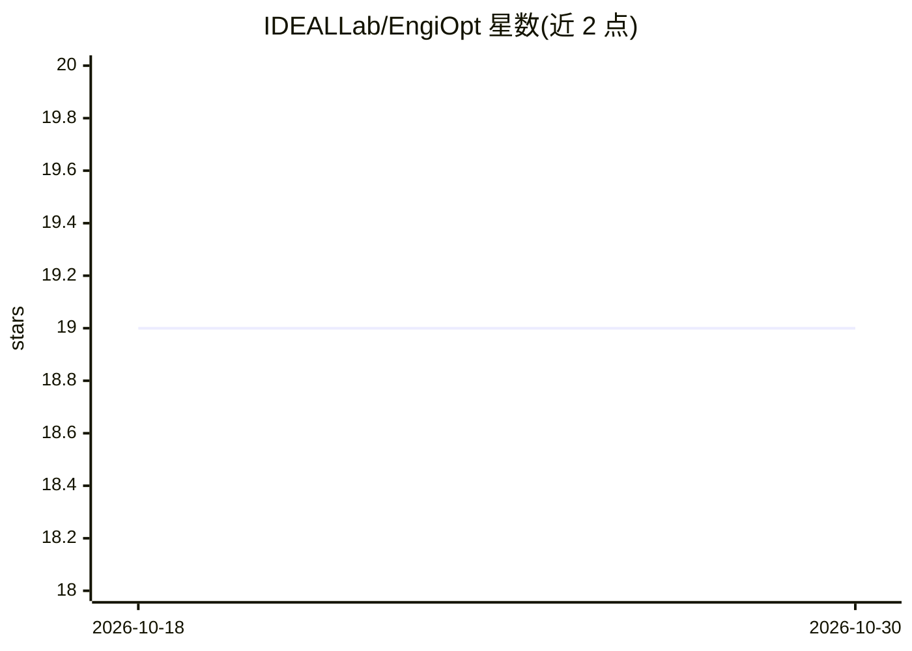

# IDEALLab/EngiOpt

⭐ 19 · Jupyter Notebook · GPL-3.0 · 推送 2026-10-01 · [GitHub](https://github.com/IDEALLab/EngiOpt) · [官网](https://engibench.ethz.ch/) · 组织维护

**工程设计问题的逆向设计与优化算法基准库（EngiBench 兼容）**

面向工程设计研究者的优化与机器学习算法代码库，遵循 CleanRL 单文件实现理念，收录 cGAN、Diffusion、VQGAN、PixelCNN++ 等 15 个逆向设计/代理模型算法，作为 EngiBench 的示例用法与对比基线。提供共享评估命令（engiopt.evaluate）、基于 HuggingFace 的检查点托管、CSV 排行榜（含 novelty/copy_rate 等完整性指标与验证重跑机制）。评估依赖从源码安装的 EngiBench（PyPI 版数据集版本不一致），权重仅 4 个算法有公开检查点，其余需自行训练。

## 筛选速览

| 维度 | 判定 | 备注 |
|---|---|---|
| AI 角色 | `ai-native` | 本体是模型或模型工具 |
| 许可风险 | `viral` | GPL-3.0 |
| 部署形态 | `library` | 以包/库形式分发 |
| 模型依赖 | — | README 未给出锁定关系 |
| 硬件要求 | — | 无带数字的原话,不猜 |
| 安装摩擦 | `medium` | 含编译或系统依赖之一 |
| 成熟度 | — | 结构信号不足 |

## 能力要点

- 15 个算法：cGAN/Diffusion/VQGAN/PixelCNN++ 逆向设计与 MLP 代理模型
- 统一评估器与排行榜，按 (problem, spec_version) 分组排名，支持验证重跑
- 检查点托管于 HuggingFace，记录仓库/路径/revision/内容哈希保证可追溯
- novelty/copy_rate/cond_sens 完整性诊断指标检测查表作弊

## 适用场景

- 为工程设计逆向设计研究提供可复现的对比基线
- 在 EngiBench 问题上训练并评估自己的生成模型
- 查阅各算法在公开排行榜上的得分与实现细节

## 场景标签

`模型评测` · 领域:评测与运维

## 证据(README 行号)

> L11: This repository contains the code for optimization and machine learning algorithms for engineering design problems.
> L22: **Algorithm** | **Class** | **Dimensions** | **Conditional?** | **Model**
> L36: surrogate_model | Surrogate Model | 1D | ❌ | MLP

## 星数曲线

2026-10-18 19 → 2026-10-30 19（+0）

---
*卡片 v1 · prompt 1.4 · 生成 2026-10-29 · 置信度 high · 依据 README sha `4f58f292bdbc` · [字段定义](../../DATASET.md)*
