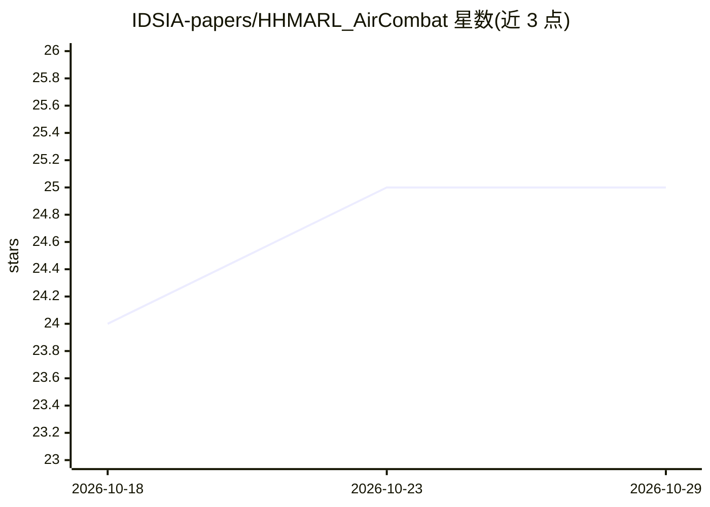

# IDSIA-papers/HHMARL_AirCombat

⭐ 25 · Python · 推送 2026-06-23 · [GitHub](https://github.com/IDSIA-papers/HHMARL_AirCombat) · 组织维护

**空战模拟的异构分层多智能体强化学习官方实现**

论文 Coordinated Strategies in Realistic Air Combat by Hierarchical Multi-Agent Reinforcement Learning 的官方代码实现。基于 JSBSim 飞行动力学环境，两阶段训练：低层课程学习（cannon/track/escape 三技能，L1-L4 逐级手动恢复检查点）与高层指挥官策略（将预训练低层策略分配给各机协同作战）。自研实现 MAPPO、MASPO、MARS 三种算法（论文原基于 Ray RLlib），支持 F16/A4 异构机型混编、GRU 与跨智能体注意力层，PyGame 渲染并开发中支持 Skybolt。面向科研复现与实验。

## 筛选速览

| 维度 | 判定 | 备注 |
|---|---|---|
| AI 角色 | `ai-native` | 本体是模型或模型工具 |
| 许可风险 | `none` | — |
| 部署形态 | `None` |  |
| 模型依赖 | — | README 未给出锁定关系 |
| 硬件要求 | — | 无带数字的原话,不猜 |
| 安装摩擦 | `medium` | 含编译或系统依赖之一 |
| 成熟度 | `idea` | |

## 能力要点

- 低层技能课程学习 + 高层指挥官分层训练架构
- 自研 MAPPO/MASPO/MARS 算法实现（论文原基于 Ray RLlib）
- F16/A4 异构机型混编配置
- GRU 循环层与跨智能体注意力层（互斥可选）

## 适用场景

- 复现论文中的分层空战多智能体强化学习实验
- 在 JSBSim 环境上训练空战协同策略并统计胜率
- 对比 MAPPO/MASPO/MARS 算法在空战任务上的表现

## 场景标签

`多智能体` `强化学习` `科研工具` · 领域:Agent 开发

## 证据(README 行号)

> L2: 3D Heterogeneous Hierarchical MARL for realistic Air Combat Simulation. This is the official implementation of this 
> L8: Training proceeds in two stages on top of a JSBSim-based flight dynamics environment:

## 星数曲线

2026-10-18 24 → 2026-10-29 25（+1）

---
*卡片 v1 · prompt 1.4 · 生成 2026-10-27 · 置信度 high · 依据 README sha `1f5cbf886421` · [字段定义](../../DATASET.md)*
