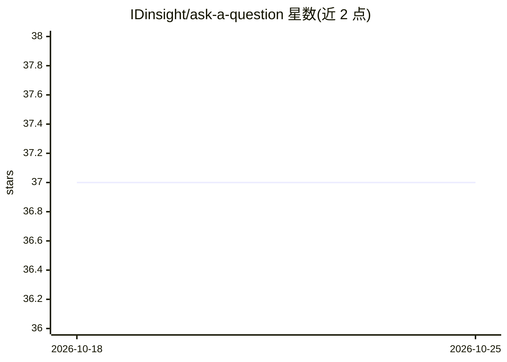

# IDinsight/ask-a-question

⭐ 37 · Python · BSD-3-Clause · 推送 2026-10-13 · [GitHub](https://github.com/IDinsight/ask-a-question) · [官网](https://ask-a-question.com) · 组织维护

**面向社会部门的 FAQ 问答系统：LLM 检索并生成公民咨询回复**

免费开源的问答工具，供非营利组织、发展中国家政府和社会部门组织用大语言模型以本地语言回应公民咨询。核心机制：基于 LLM embedding 对数据库内容做余弦相似度检索，可选生成 LLM 定制回复；通过 API 与 Turn.io、Glific、Typebot 等聊天机器人平台集成；提供内容管理后台、消息分诊（按自定义标准识别紧急/重要消息）与内容表现分析仪表盘。架构上用 docker-compose 编排容器，经反向代理管理流量，数据库与 LiteLLM 代理仅供核心应用访问。对话式追问、多媒体回复等功能列为规划中。

## 筛选速览

| 维度 | 判定 | 备注 |
|---|---|---|
| AI 角色 | `ai-native` | 本体是模型或模型工具 |
| 许可风险 | `permissive` | BSD-3-Clause |
| 部署形态 | `None` |  |
| 模型依赖 | — | README 未给出锁定关系 |
| 硬件要求 | — | 无带数字的原话,不猜 |
| 安装摩擦 | `low` | 无编译、无系统依赖或容器化 |
| 成熟度 | — | 结构信号不足 |

## 能力要点

- embedding 余弦相似度内容检索，可选生成 LLM 定制回复
- API 集成 Turn.io、Glific、Typebot 等聊天机器人平台
- 按自定义标准的消息分诊（识别紧急/重要消息）
- 内容管理后台与内容表现分析仪表盘

## 适用场景

- 让公益或政府聊天机器人自动回答公民咨询
- 分析哪些内容被频繁询问、哪些内容缺失
- 识别咨询中的紧急消息以便人工介入

## 场景标签

`聊天机器人` `RAG` · 领域:对话与助手

## 证据(README 行号)

> L10: **Ask A Question** is a free and open-source tool created to help non-profit organizations, governments in developi
> L16: Match your questions to content in the database using embeddings from LLMs.
> L18: #### **:robot: LLM responses**

## 星数曲线

2026-10-18 37 → 2026-10-25 37（+0）

---
*卡片 v1 · prompt 1.4 · 生成 2026-10-25 · 置信度 high · 依据 README sha `d85f13e6ee81` · [字段定义](../../DATASET.md)*
