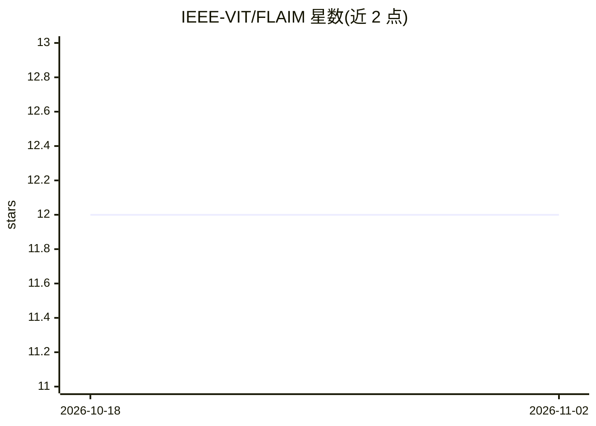

# IEEE-VIT/FLAIM

⭐ 12 · Python · 推送 2026-07-07 · [GitHub](https://github.com/IEEE-VIT/FLAIM) · 组织维护

**联邦学习胸部 X 光诊断框架：多医院不共享原始数据协同训练**

基于 Flower 的联邦学习框架，让多家医院在本地各自训练胸部 X 光诊断模型（ImageNet 预训练 DenseNet121 微调，多标签分类），仅上传模型更新，由中心聚合器用 FedAvg 聚合成全局模型。隐私机制包括基于 Opacus 的差分隐私（逐样本梯度裁剪、噪声注入、隐私预算 ε 追踪）与聚合级拜占庭异常检测钩子。各节点与聚合器均以 FastAPI 服务运行，使用 Ngrok/gRPC 通信，数据集为 PadChest，支持单机多客户端模拟、检查点续训与监控仪表盘。

## 筛选速览

| 维度 | 判定 | 备注 |
|---|---|---|
| AI 角色 | `ai-native` | 本体是模型或模型工具 |
| 许可风险 | `none` | — |
| 部署形态 | `library` | 以包/库形式分发 |
| 模型依赖 | — | README 未给出锁定关系 |
| 硬件要求 | — | 无带数字的原话,不猜 |
| 安装摩擦 | `low` | 无编译、无系统依赖或容器化 |
| 成熟度 | — | 结构信号不足 |

## 能力要点

- Flower + FedAvg 多医院节点联邦训练，原始影像不出院
- Opacus 差分隐私：梯度裁剪、噪声注入、隐私预算 ε 追踪
- DenseNet121 迁移学习，PadChest 多标签疾病分类
- FastAPI 节点/聚合器服务与仪表盘（节点状态、精度、隐私预算可视化）

## 适用场景

- 多家医院在合规前提下协同训练胸部 X 光诊断模型
- 在单机上模拟多个联邦客户端验证训练流程
- 通过 /diagnose 接口用全局模型对上传 X 光做推理

## 场景标签

`微调` `目标检测` · 领域:感知与多模态

## 证据(README 行号)

> L3: A federated learning framework that enables multiple hospitals to collaboratively train a chest X-ray diagnosis mode
> L38: - ImageNet-pretrained DenseNet121
> L190: |`/diagnose`|Diagnose uploaded X-ray|

## 星数曲线

2026-10-18 12 → 2026-11-02 12（+0）

---
*卡片 v1 · prompt 1.4 · 生成 2026-11-01 · 置信度 high · 依据 README sha `86d9ef6b5886` · [字段定义](../../DATASET.md)*
