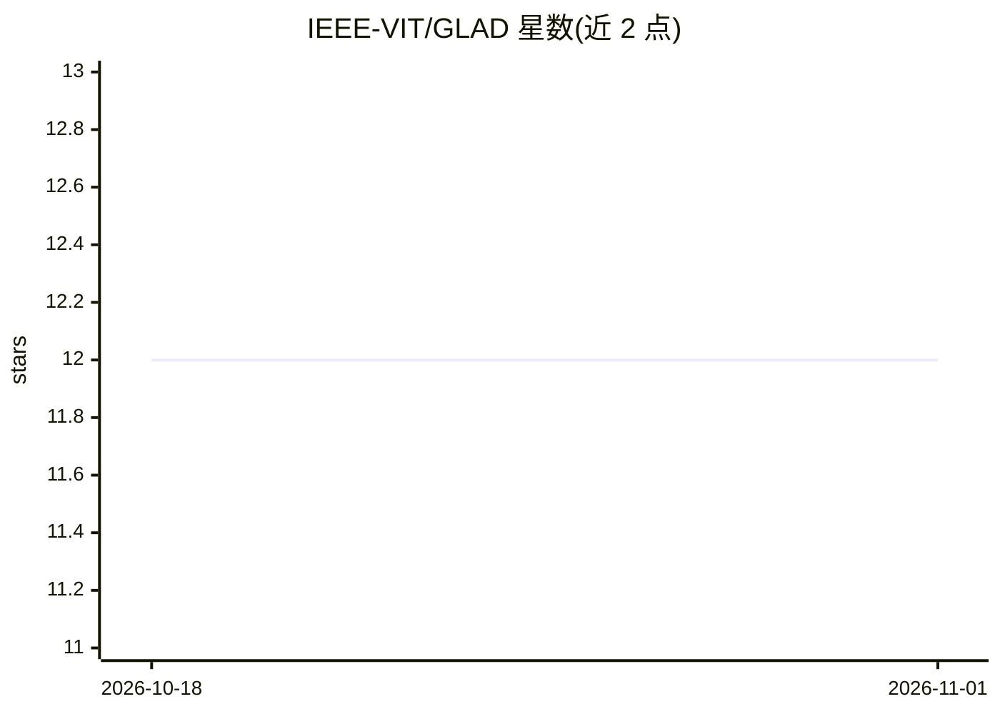

# IEEE-VIT/GLAD

⭐ 12 · HTML · MIT · 推送 2026-07-06 · [GitHub](https://github.com/IEEE-VIT/GLAD) · 组织维护

**无人机载气体泄漏检测系统：边缘 ML 融合多传感器数据**

面向炼油厂、管道、化工厂等高风险工业场景的 IoT 无人机巡检系统：ESP32 实时采集 NDIR 气体与 MLX 热成像数据，Raspberry Pi 4 在机载端运行 OpenCV 视觉分析与 PyTorch（MobileNetV2）多模态传感器融合，经 MQTT/WebSockets 推送到浏览器仪表盘，输出泄漏置信度分数。视觉模型在 5,348 张香蕉叶图像的自建数据集上训练，验证准确率 80.56%。需自行组装四旋翼硬件并烧录 ESP32 固件。

## 筛选速览

| 维度 | 判定 | 备注 |
|---|---|---|
| AI 角色 | `ai-native` | 本体是模型或模型工具 |
| 许可风险 | `permissive` | MIT |
| 部署形态 | `library` | 以包/库形式分发 |
| 模型依赖 | — | README 未给出锁定关系 |
| 硬件要求 | — | 无带数字的原话,不猜 |
| 安装摩擦 | `low` | 无编译、无系统依赖或容器化 |
| 成熟度 | — | 结构信号不足 |

## 能力要点

- ESP32 采集 NDIR 气体/MLX 热数据，Raspberry Pi 4 边缘推理，无需云端
- MobileNetV2 植被褪绿检测（验证准确率 80.56%），与气体/温度数据融合生成泄漏置信度
- MQTT/WebSockets 遥测管道与实时网页仪表盘
- 提供 Fusion360 机架设计与 PlatformIO 固件流程

## 适用场景

- 对高风险工业区进行气体泄漏的远程无人机巡检
- 通过植被褪绿等视觉线索定位地下气体泄漏
- 在仪表盘实时查看气体浓度、环境指标与告警

## 场景标签

`多模态` `目标检测` · 领域:感知与多模态

## 证据(README 行号)

> L9: The system leverages a distributed edge-computing architecture: an **ESP32** handles real-time, low-latency sensor a
> L27: * **Machine Learning:** PyTorch (Sensor Fusion / CNN / MobileNetV2)
> L58: * Gas sensor readings, thermal information, and computer vision outputs are fused using a machine learning model to

## 星数曲线

2026-10-18 12 → 2026-11-01 12（+0）

---
*卡片 v1 · prompt 1.4 · 生成 2026-11-01 · 置信度 high · 依据 README sha `bcb278e9bf6b` · [字段定义](../../DATASET.md)*
