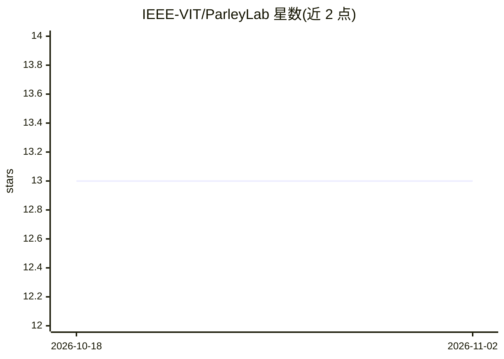

# IEEE-VIT/ParleyLab

⭐ 13 · Python · MIT · 推送 2026-09-18 · [GitHub](https://github.com/IEEE-VIT/ParleyLab) · 组织维护

**面向用户的 AI 谈判训练模拟器：PPO 对手+LLM 对话+实时点评**

用户在薪资、自由职业合同、租房、股权四类场景中与 AI 对手进行结构化谈判练习：PPO 强化学习策略决定对手的战略行为（坚持/让步/虚张声势/离场），LLM 将其转译为自然语言；独立 critic agent 依据谈判理论对每步操作给出 JSON 格式的优缺点与建议。对手的隐藏目标与 BATNA 仅存服务端。LLM 后端可在 Gemini/Groq/Ollama 间切换，LLM 不可用时有模板降级。本地前后端分别以 FastAPI 和 Next.js 运行，面向终端学习者。

## 筛选速览

| 维度 | 判定 | 备注 |
|---|---|---|
| AI 角色 | `ai-native` | 本体是模型或模型工具 |
| 许可风险 | `permissive` | MIT |
| 部署形态 | `library` | 以包/库形式分发 |
| 模型依赖 | local-ok | 支持本地模型 |
| 硬件要求 | `cpu-ok` | |
| 安装摩擦 | `low` | 无编译、无系统依赖或容器化 |
| 成熟度 | — | 结构信号不足 |

## 能力要点

- PPO 策略与 LLM 语言生成分离的架构
- 每轮实时 critic 点评（优势/弱点/建议/概念标签）
- 隐藏状态三层防护，会话结束才揭示对手底牌
- 浏览器端 Web Speech API 语音输入与多币种支持

## 适用场景

- 练习薪资谈判并获得基于谈判理论的逐步反馈
- 模拟租房或自由职业合同谈判对抗自适应 AI 对手
- 查看对手隐藏目标与最终表现评分复盘谈判过程

## 场景标签

`多智能体` · 领域:Agent 开发

## 证据(README 行号)

> L3: ParleyLab is an AI-powered negotiation training simulator. Users practice structured negotiation scenarios — salary 
> L10: - RL-driven opponent: a PPO agent controls strategic decisions independently of language generation

## 星数曲线

2026-10-18 13 → 2026-11-02 13（+0）

---
*卡片 v1 · prompt 1.4 · 生成 2026-10-31 · 置信度 mid · 依据 README sha `a00ee1950ffa` · [字段定义](../../DATASET.md)*
