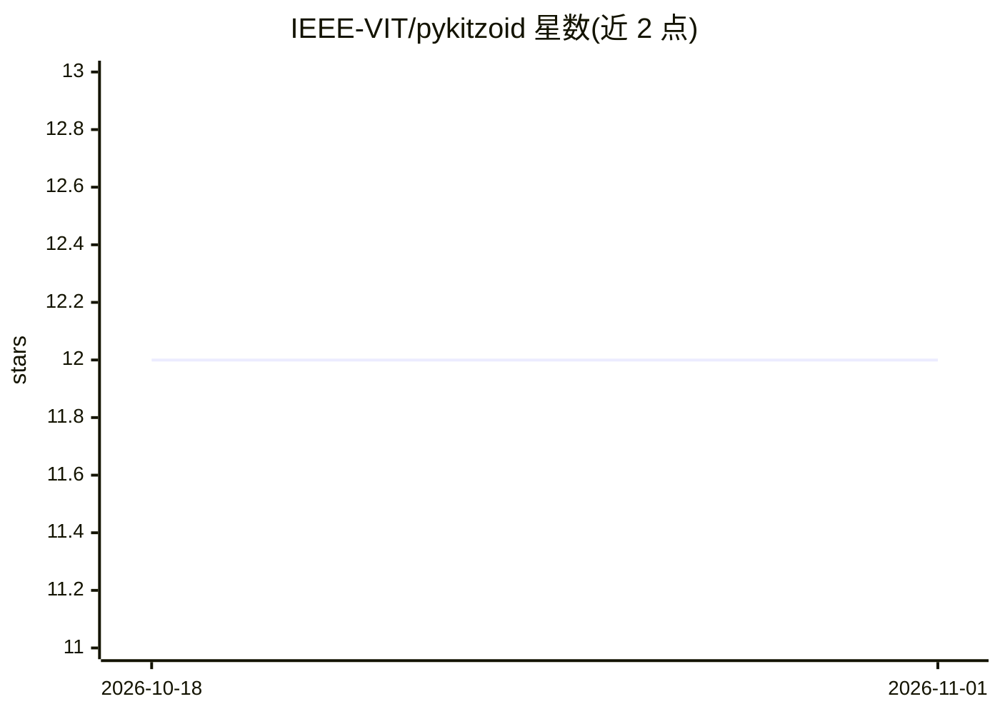

# IEEE-VIT/pykitzoid

⭐ 12 · Go · MIT · 推送 2026-09-14 · [GitHub](https://github.com/IEEE-VIT/pykitzoid) · 组织维护

**Go 实现的机器学习基础构件库，附 Python 包装**

以 Go 为主体语言实现的 ML 基础构件库，提供数据处理、简单模型与工具的构建块，核心逻辑在 Go 中实现（约占 93%），并带有搭建中的 Python 包装层（见 pyproject.toml），供用户从 notebook 调用而逻辑保持不变。面向学生、自学者和首次参与开源的贡献者，附 demo/ 目录中的可运行示例和 Makefile 构建目标。安装部分仅给出贡献流程的 git clone 源码方式，无 pip 发布安装命令。

## 筛选速览

| 维度 | 判定 | 备注 |
|---|---|---|
| AI 角色 | `ai-native` | 本体是模型或模型工具 |
| 许可风险 | `permissive` | MIT |
| 部署形态 | `None` |  |
| 模型依赖 | — | README 未给出锁定关系 |
| 硬件要求 | — | 无带数字的原话,不猜 |
| 安装摩擦 | `low` | 无编译、无系统依赖或容器化 |
| 成熟度 | `idea` | |

## 能力要点

- 核心算法以 Go 实现，二进制文件运行较快
- 搭建中的 Python 包装层供 notebook 中使用
- demo/ 目录提供端到端可运行示例
- MIT 许可，附 Makefile 构建目标与贡献指南

## 适用场景

- 从底层理解机器学习算法的实现方式
- 在 Go 语言流水线中试用小型 ML 算法
- 首次参与开源贡献的练习项目

## 场景标签

`教程课程` · 领域:学习与行业

## 证据(README 行号)

> L7: This is a repository containing a Python package coded in Go, with the motive of providing ML support.
> L18: - Provide clear, well-documented building blocks for ML (data handling, simple models, utilities) implemented prima

## 星数曲线

2026-10-18 12 → 2026-11-01 12（+0）

---
*卡片 v1 · prompt 1.4 · 生成 2026-11-01 · 置信度 high · 依据 README sha `3c9b157fe1b3` · [字段定义](../../DATASET.md)*
