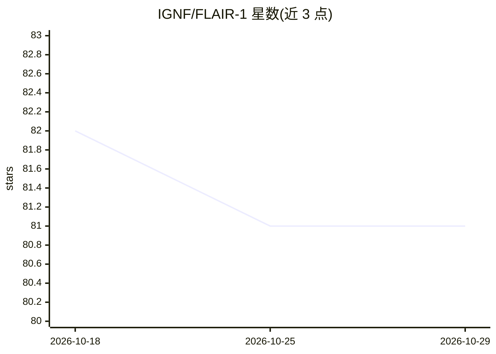

# IGNF/FLAIR-1

⭐ 81 · Python · Apache-2.0 · 推送 2026-07-30 · [GitHub](https://github.com/IGNF/FLAIR-1) · 组织维护

**法国 IGN 航空影像土地覆盖语义分割基线库**

法国国家地理与森林信息研究所（IGN）发布的 FLAIR #1 挑战赛基线库：基于 PyTorch Lightning 训练 U-Net（ResNet34 编码器，约 24.4M 参数）对 512×512、5 通道（RGB-红外-高程）航空影像做 13/19 类土地覆盖语义分割，支持元数据编码与数据增强策略。提供 flair 命令行入口（训练/预测/mIoU 指标）与 zone_detect 模块（对单个地理参考 TIFF 做重叠滑窗大尺度推理），通过 YAML 配置，模型可选 HuggingFace 或 segmentation-models-pytorch 提供。附带数据集与 HuggingFace 预训练模型链接。

## 筛选速览

| 维度 | 判定 | 备注 |
|---|---|---|
| AI 角色 | `ai-native` | 本体是模型或模型工具 |
| 许可风险 | `permissive` | Apache-2.0 |
| 部署形态 | `None` |  |
| 模型依赖 | — | README 未给出锁定关系 |
| 硬件要求 | — | 无带数字的原话,不猜 |
| 安装摩擦 | `medium` | 含编译或系统依赖之一 |
| 成熟度 | — | 结构信号不足 |

## 能力要点

- U-Net + ResNet34 基线，支持元数据浅层 MLP 编码与几何增强
- flair 命令：训练/预测/mIoU 指标计算一体化
- zone_detect：对地理参考 TIFF 做带 margin 的重叠滑窗推理
- FLAIR #1 数据集：超 200 亿标注像素、全国尺度时空域采样

## 适用场景

- 复现 FLAIR #1 土地覆盖分割挑战基线
- 训练自己的航空影像语义分割模型并计算 mIoU
- 对大范围正射影像图执行土地覆盖制图推理

## 场景标签

`目标检测` · 领域:感知与多模态

## 证据(README 行号)

> L2: # Semantic segmentation and domain adaptation for land-cover from aerial imagery
> L29: The FLAIR #1 dataset is sampled countrywide and is composed of over 20 billion annotated pixels, acquired over thre
> L49: A U-Net architecture with a pre-trained ResNet34 encoder from the pytorch segmentation models library is used for t

## 星数曲线

2026-10-18 82 → 2026-10-29 81（-1）

---
*卡片 v1 · prompt 1.4 · 生成 2026-10-24 · 置信度 high · 依据 README sha `1f7671344d51` · [字段定义](../../DATASET.md)*
