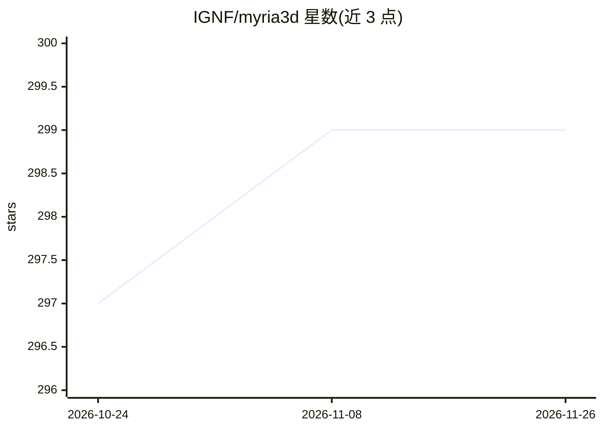

# IGNF/myria3d

⭐ 299 · Python · BSD-3-Clause · 推送 2026-10-29 · [GitHub](https://github.com/IGNF/myria3d) · [官网](https://ignf.github.io/myria3d/) · 组织维护

**面向开发者的大规模航空激光点云语义分割深度学习库**

Myria3D 是一个聚焦范围明确的 PyTorch 深度学习库，用于大规模高密度航空 Lidar 点云的多类语义分割：实现 3D 分割网络的训练，包含优化的数据处理与拟合期评估逻辑，并支持对未见的大规模点云做推理。模型评估通过全点云上的单类 IoU 进行。库基于 PyTorch-Geometric 数据格式，结构依赖 Hydra 与 PyTorch-Lightning 以支持灵活的实验迭代。初始设计面向法国 Lidar HD 项目（10 点/m² 的法国三维制图），生产版本 Release 附带训练好的模型与推理配置。

## 筛选速览

| 维度 | 判定 | 备注 |
|---|---|---|
| AI 角色 | `ai-native` | 本体是模型或模型工具 |
| 许可风险 | `permissive` | BSD-3-Clause |
| 部署形态 | `None` |  |
| 模型依赖 | — | README 未给出锁定关系 |
| 硬件要求 | — | 无带数字的原话,不猜 |
| 安装摩擦 | `low` | 无编译、无系统依赖或容器化 |
| 成熟度 | — | 结构信号不足 |

## 能力要点

- 训练 3D 分割神经网络，含拟合期数据处理与评估逻辑
- 支持对未见大规模点云的推理
- 基于全点云的单类 IoU 模型评估
- 生产 Release 附带训练好的多类分割模型与配置文件

## 适用场景

- 对高密度航空 Lidar 点云执行多类语义分割（地面/植被/建筑等）
- 在法国 Lidar HD 数据上直接使用发布的模型做推理
- 训练和迭代自定义的点云分割实验配置

## 场景标签

 · 领域:遥感/地理空间深度学习

## 证据(README 行号)

> L10: Myria3D is a deep learning library designed with a focused scope: the multiclass semantic segmentation of large sca
> L12: The library implements the training of 3D Segmentation neural networks, with optimized data-processing and evaluati

## 星数曲线

2026-10-24 297 → 2026-11-26 299（+2）

---
*卡片 v1 · prompt 1.4 · 生成 2026-11-25 · 置信度 high · 依据 README sha `d88c7a0546fa` · [字段定义](../../DATASET.md)*
