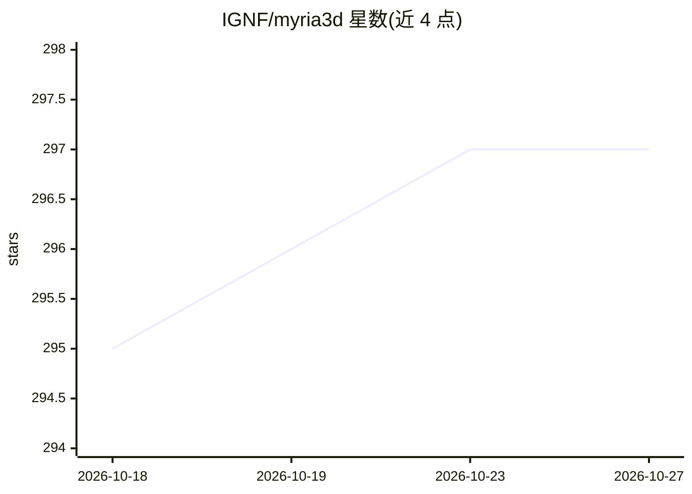

# IGNF/myria3d

⭐ 297 · Python · BSD-3-Clause · 推送 2026-10-26 · [GitHub](https://github.com/IGNF/myria3d) · [官网](https://ignf.github.io/myria3d/) · 组织维护

**机载激光雷达点云多类语义分割的深度学习库**

基于 PyTorch、Pytorch-Lightning 与 Hydra 构建的深度学习库，面向大规模高密度机载激光雷达点云的多类语义分割：支持 3D 分割网络的训练（含 fit 时优化的数据处理与评估逻辑）、对未见大规模点云的推理，以及全点云单类 IoU 评估。数据格式沿用 Pytorch-Geometric 标准，初始面向法国 Lidar HD 项目（地面/植被/建筑/车辆/桥梁等类别）。Release 附带训练好的多类分割模型及推理配置文件。安装与用法指向其文档。

## 筛选速览

| 维度 | 判定 | 备注 |
|---|---|---|
| AI 角色 | `ai-native` | 本体是模型或模型工具 |
| 许可风险 | `permissive` | BSD-3-Clause |
| 部署形态 | `None` |  |
| 模型依赖 | — | README 未给出锁定关系 |
| 硬件要求 | — | 无带数字的原话,不猜 |
| 安装摩擦 | `low` | 无编译、无系统依赖或容器化 |
| 成熟度 | — | 结构信号不足 |

## 能力要点

- 3D 语义分割网络训练与大规模点云推理
- 全点云单类 IoU 评估
- 基于 Pytorch-Geometric 标准数据格式
- Release 提供训练好的多类分割模型与推理配置

## 适用场景

- 训练机载激光雷达点云多类语义分割模型
- 对法国 Lidar HD 等大规模点云数据执行分割推理
- 以全点云 IoU 指标评估分割模型

## 场景标签

 · 领域:遥感/地理空间 AI

## 证据(README 行号)

> L10: Myria3D is a deep learning library designed with a focused scope: the multiclass semantic segmentation of large sca
> L12: The library implements the training of 3D Segmentation neural networks, with optimized data-processing and evaluati

## 星数曲线

2026-10-18 295 → 2026-10-27 297（+2）

---
*卡片 v1 · prompt 1.4 · 生成 2026-10-21 · 置信度 high · 依据 README sha `0dde1700930b` · [字段定义](../../DATASET.md)*
