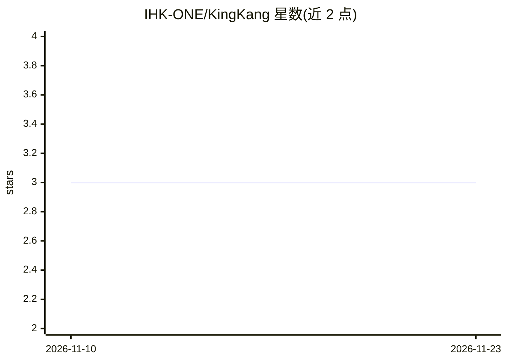

# IHK-ONE/KingKang

⭐ 3 · Kotlin · Apache-2.0 · 推送 2026-11-19 · [GitHub](https://github.com/IHK-ONE/KingKang) · 个人维护 · 中文 README

**在 Android 手机上免 root 运行 Kali 并对话安全 Agent**

一个原生 Android 应用，在应用私有目录以 PRoot 方式运行 Kali Linux，无需 root 与刷机；同时承载 DeepSeek Harness Agent 的对话界面，支持流式回复、工具卡片、子 Agent 下钻与权限控制。终端、工作区文件、插件管理与设备能力自检（OTG 网卡、Shizuku ADB）集成在同一应用内。提供 APK 安装包与 JDK 17/Android SDK 的源码构建路径。限制：PRoot 下无法使用原始套接字、抓包与 monitor 模式；APK 为 debug 签名。

## 筛选速览

| 维度 | 判定 | 备注 |
|---|---|---|
| AI 角色 | `ai-ecosystem` | LLM/agent 周边工具 |
| 许可风险 | `permissive` | Apache-2.0 |
| 部署形态 | `None` |  |
| 模型依赖 | locked-api |  |
| 硬件要求 | — | 无带数字的原话,不猜 |
| 安装摩擦 | `medium` | 含编译或系统依赖之一 |
| 成熟度 | — | 结构信号不足 |

## 能力要点

- PRoot 用户空间运行 Kali Linux，无需 root 与刷机
- 原生对话界面承载 DeepSeek Harness：流式回复、工具卡片、审批与子 Agent
- OTG USB 网卡检测与 Shizuku ADB shell（shell 权限）
- 运行环境自检：实测 TCP、DNS、原始套接字、抓包等能力

## 适用场景

- 在手机上进行获得授权的安全测试与教学实验
- 不需要电脑即可运行 Kali 终端并执行命令
- 与安全研究 Agent 对话完成测试任务

## 场景标签

`网络安全` `聊天机器人` · 领域:对话与助手

## 证据(README 行号)

> L3: 在一台 Android 手机上运行完整的 Kali Linux，并直接和安全研究 Agent 对话。
> L5: 不需要电脑、不需要刷机、不需要 root。Kali、终端、DeepSeek Harness 与原生对话界面都在同一台设备里；对话、文件和命令结果留在本机，只有发给模型的请求会离开设备。
> L41: Kali 运行在应用私有目录里的 PRoot 用户空间，不修改系统分区，也不需要 root。Agent 的每条命令都在同一个 Kali 里执行，你随时可以打开「Kali 终端」接手。
> L95: 在「设置 → Agent 核心 → DeepSeek 官方凭据」填入 API Key 并保存，或在「模型提供方」里配置自己的供应商。等待状态变为「已配置」、Agent 连接就绪即可。

## 星数曲线

2026-11-10 3 → 2026-11-23 3（+0）

---
*卡片 v1 · prompt 1.4 · 生成 2026-11-22 · 置信度 high · 依据 README sha `6206cfceffed` · [字段定义](../../DATASET.md)*
