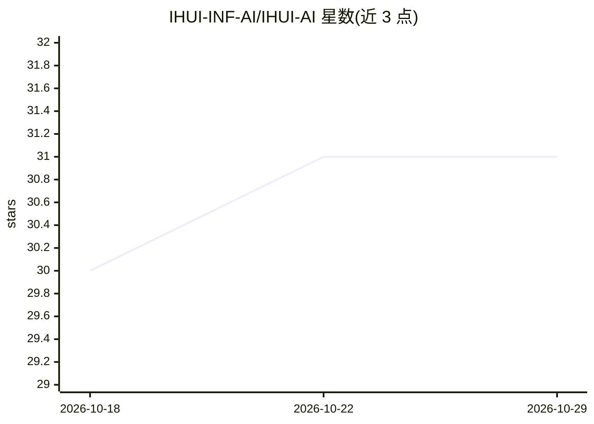

# IHUI-INF-AI/IHUI-AI

⭐ 31 · TypeScript · Apache-2.0 · 推送 2026-10-28 · [GitHub](https://github.com/IHUI-INF-AI/IHUI-AI) · [官网](https://aizhs.top) · 个人维护 · 中文 README

**自托管全栈 AI 平台：模型网关+Agent 编排+多租户后端+8 端前端**

个人开发者维护的自托管全栈 AI 平台 monorepo：业务后端为 Fastify 5 + Drizzle + PostgreSQL（行级安全 RLS 多租户、pgvector），AI 服务为 FastAPI + LangGraph + LiteLLM + MCP，声称入库 118 个模型；前端覆盖 Web、API、小程序、移动 App、桌面（Tauri）、浏览器扩展、CLI 与 Capacitor 壳共 9 个 app 包。提供 Docker Compose 一条命令部署与本地 pnpm 开发模式，环境需 Node.js≥20、PostgreSQL≥15+pgvector、Redis≥7、Python≥3.12。采用 Apache-2.0 与商用授权的双许可模式，源码嵌入版权溯源水印并设 CI 校验。README 大量数字由脚本现场统计生成。

## 筛选速览

| 维度 | 判定 | 备注 |
|---|---|---|
| AI 角色 | `ai-ecosystem` | LLM/agent 周边工具 |
| 许可风险 | `permissive` | Apache-2.0 |
| 部署形态 | `desktop` | 安装包/桌面程序 |
| 模型依赖 | — | README 未给出锁定关系 |
| 硬件要求 | — | 无带数字的原话,不猜 |
| 安装摩擦 | `low` | 无编译、无系统依赖或容器化 |
| 成熟度 | — | 结构信号不足 |

## 能力要点

- LiteLLM 模型网关 + LangGraph Agent 编排 + MCP，声称入库 118 个模型
- PostgreSQL 行级安全（RLS）多租户，配 pgvector 向量检索与 Redis
- 9 个 app 包覆盖 Web/API/小程序/移动/桌面/扩展/CLI，16 个共享包
- Docker Compose 一条命令部署，提供迁移、监控、蓝绿发布等运维文档

## 适用场景

- 自托管一套带多租户与计费的 AI SaaS 平台
- 通过统一网关接入多家 LLM 并编排 Agent 与 RAG 知识库
- 一套代码库同时交付 Web、小程序、移动、桌面与浏览器扩展多端

## 场景标签

`Agent 框架` `模型网关` `RAG` `聊天机器人` · 领域:Agent 开发

## 证据(README 行号)

> L23:  自托管的全栈 AI 平台 :模型网关 + Agent 编排 + 多租户业务后端 + 8 端前端 · Apache 2.0 商业可用 · 5 分钟 Fork 到上线
> L45: |一句话|自托管的全栈 AI 平台:模型网关 + Agent 编排 + 多租户业务后端 + 8 端前端|
> L137: |AI 服务|`apps/ai-service`|FastAPI + LangGraph + LiteLLM + MCP|模型网关、Agent 引擎、RAG、工作流|

## 星数曲线

2026-10-18 30 → 2026-10-29 31（+1）

---
*卡片 v1 · prompt 1.4 · 生成 2026-10-26 · 置信度 high · 依据 README sha `a8478f28ca3b` · [字段定义](../../DATASET.md)*
