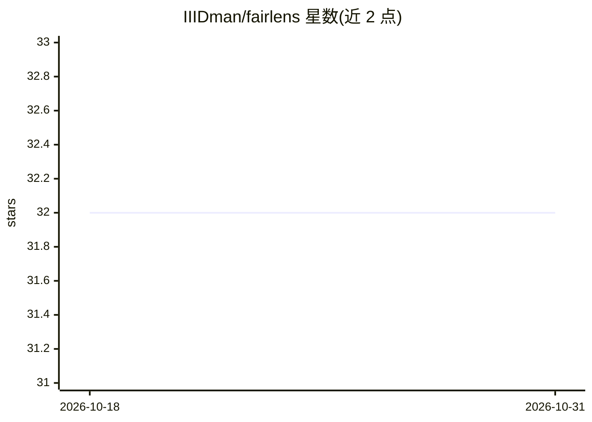

# IIIDman/fairlens

⭐ 32 · Python · MIT · 推送 2026-02-25 · [GitHub](https://github.com/IIIDman/fairlens) · 个人维护

**面向开发者的轻量级 ML 模型与数据集偏差检测工具包**

Python 公平性审计库（Python 3.8+，MIT 许可）：对数据集做分组标签率统计、差异标记与代理变量检查，对模型输出公平性审计报告（人口统计平等比、机会均等等指标，阈值参照 disparate impact 的 80% 规则）；支持校准误差、个体公平性、交叉群体、多分类（one-vs-rest）指标与 bootstrap 置信区间；内置 ThresholdOptimizer 后处理与 Reweighter 预处理两种缓解手段，可生成 HTML/Markdown 报告。自带合成版基准数据集（Adult/COMPAS 等），可从 OpenML 拉取真实数据。作者定位为快速检查场景，README 声明不替代 AIF360/Fairlearn 的完整研究工具链。

## 筛选速览

| 维度 | 判定 | 备注 |
|---|---|---|
| AI 角色 | `ai-ecosystem` | LLM/agent 周边工具 |
| 许可风险 | `permissive` | MIT |
| 部署形态 | `library` | 以包/库形式分发 |
| 模型依赖 | — | README 未给出锁定关系 |
| 硬件要求 | — | 无带数字的原话,不猜 |
| 安装摩擦 | `low` | 无编译、无系统依赖或容器化 |
| 成熟度 | — | 结构信号不足 |

## 能力要点

- 数据集分析：分组标签率、差异标记、代理变量检查
- 组公平性/校准/个体公平性/交叉群体/多分类指标，含 bootstrap 置信区间
- ThresholdOptimizer 后处理与 Reweighter 预处理两种偏差缓解方法
- 内置合成公平性基准数据集，可从 OpenML 拉取真实数据（离线自动回退）

## 适用场景

- 模型上线前快速检查数据集与模型是否存在偏差问题
- 对分类模型生成可分享的公平性审计报告
- 用阈值优化或重加权缓解检测到的偏差

## 场景标签

`模型评测` · 领域:评测与运维

## 证据(README 行号)

> L7: A lightweight toolkit for detecting bias in ML models and datasets.
> L52: FAIRNESS AUDIT REPORT - UNFAIR

## 星数曲线

2026-10-18 32 → 2026-10-31 32（+0）

---
*卡片 v1 · prompt 1.4 · 生成 2026-10-26 · 置信度 high · 依据 README sha `6fb0ac14662d` · [字段定义](../../DATASET.md)*
