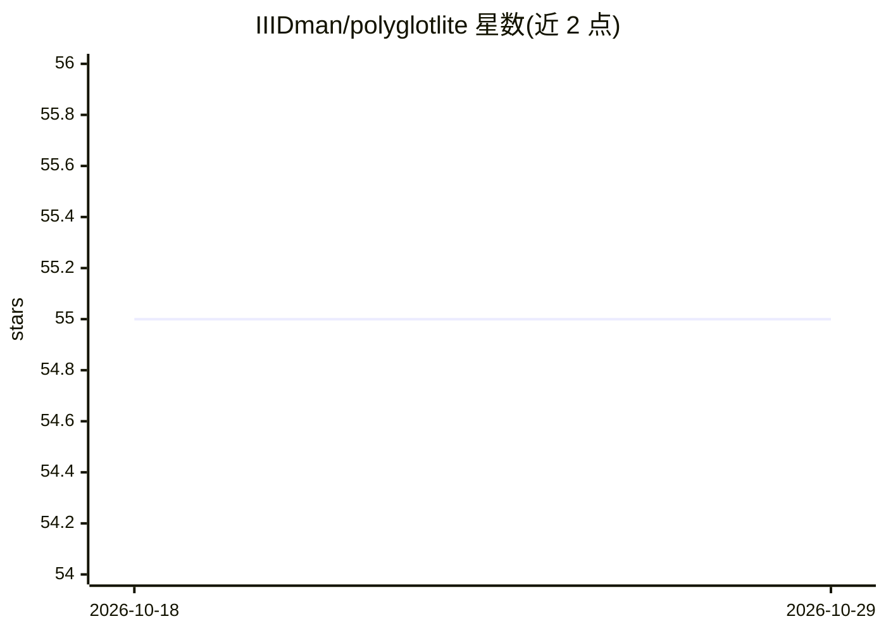

# IIIDman/polyglotlite

⭐ 55 · Python · MIT · 推送 2026-01-08 · [GitHub](https://github.com/IIIDman/polyglotlite) · 个人维护

**面向消费级硬件的轻量多语言模型训练与运行工具包**

PolyglotLite 是用于训练和运行 100M-500M 参数多语言语言模型的 Python 工具包，面向希望在本机（无云端 GPU）实验多语言 NLP 的开发者。提供模型架构、训练/微调 Trainer、50+ 语言的语言检测工具，以及基于 transformers 加载预训练权重的 PolyglotLiteHF 接口。项目处于早期阶段：架构已实现，预训练权重仍在开发中。支持 macOS/Linux/Windows 与 Python 3.8-3.13，Apple Silicon 上默认 CPU 运行。

## 筛选速览

| 维度 | 判定 | 备注 |
|---|---|---|
| AI 角色 | `ai-native` | 本体是模型或模型工具 |
| 许可风险 | `permissive` | MIT |
| 部署形态 | `library` | 以包/库形式分发 |
| 模型依赖 | — | README 未给出锁定关系 |
| 硬件要求 | — | 无带数字的原话,不猜 |
| 安装摩擦 | `low` | 无编译、无系统依赖或容器化 |
| 成熟度 | `idea` | |

## 能力要点

- 提供 135M/360M/500M 三档参数规模的模型（FP16 内存约 270MB-1GB）
- Trainer 支持自建数据训练与自定义数据集微调
- 50+ 语言的语言检测工具（含中文、日文、阿拉伯文等）
- 通过 PolyglotLiteHF 与 transformers 加载预训练权重

## 适用场景

- 在无云端 GPU 的本机训练或微调多语言小模型
- 对多语言文本做语言检测
- 实验轻量模型架构并对比不同参数规模

## 场景标签

`微调` `模型训练` `推理引擎` · 领域:训练与推理

## 证据(README 行号)

> L8: PolyglotLite is a toolkit for training and running efficient multilingual language models (100M-500M parameters) wit
> L3: **Lightweight multilingual language models that run on consumer hardware.**

## 星数曲线

2026-10-18 55 → 2026-10-29 55（+0）

---
*卡片 v1 · prompt 1.4 · 生成 2026-10-24 · 置信度 mid · 依据 README sha `a6953a28d55f` · [字段定义](../../DATASET.md)*
