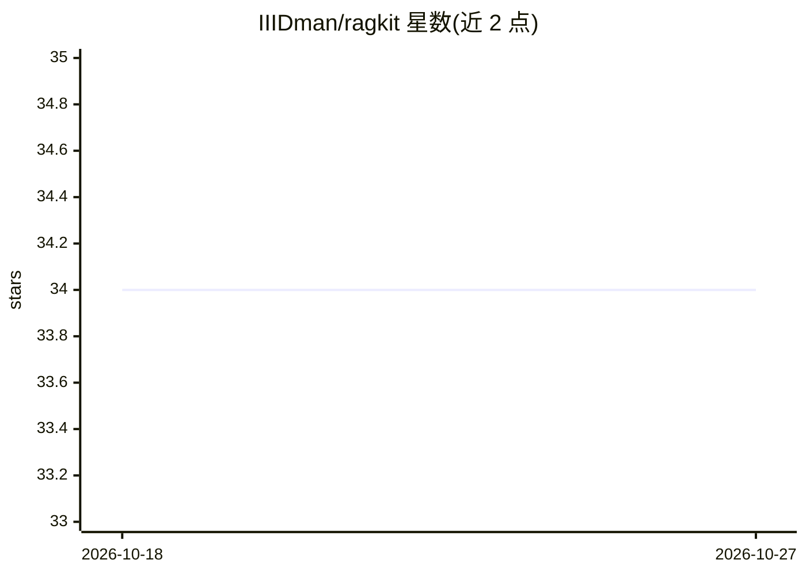

# IIIDman/ragkit

⭐ 34 · Python · MIT · 推送 2026-09-25 · [GitHub](https://github.com/IIIDman/ragkit) · 个人维护

**本地优先的轻量级 RAG 框架，构建文档问答应用**

面向开发者的 Python RAG 框架，在本地硬件上实现“与文档对话”应用：默认无 API key，基本用法约 5 行代码。核心机制包括 FAISS 稠密向量 + BM25 的混合检索（min-max 融合默认，可选 RRF）、可选交叉编码器重排、提示注入防护（分类器筛块 + 随机命名定界符）、可选 Docling 版面感知解析（DOCX/PPTX/XLSX/HTML/OCR）。LLM 后端支持 HuggingFace、Ollama 或 OpenAI API。附 BEIR 基准评测工具。作者自述功能与灵活性少于 LangChain/LlamaIndex，适合原型与简单内部工具。需 Python 3.9+，约 8GB 内存与 2GB 模型磁盘空间。

## 筛选速览

| 维度 | 判定 | 备注 |
|---|---|---|
| AI 角色 | `ai-ecosystem` | LLM/agent 周边工具 |
| 许可风险 | `permissive` | MIT |
| 部署形态 | `library` | 以包/库形式分发 |
| 模型依赖 | local-ok | 支持本地模型 |
| 硬件要求 | — | 无带数字的原话,不猜 |
| 安装摩擦 | `low` | 无编译、无系统依赖或容器化 |
| 成熟度 | — | 结构信号不足 |

## 能力要点

- FAISS 稠密检索 + BM25 关键词检索的混合融合（min-max/RRF）
- 提示注入防护：分类器筛选块 + 随机命名定界符包裹来源
- 可选 Docling 版面感知解析，处理表格、多栏页面与办公文档
- 内置 BEIR 基准评测工具，附实测检索质量数据

## 适用场景

- 对论文、报告等 PDF 提问做文档问答
- 搭建个人笔记或内部文档的检索问答系统
- 在本地无 API key 环境下原型验证 RAG 方案
- 用附带评测工具对比不同检索配置的效果

## 场景标签

`RAG` `文档问答` `文档解析` · 领域:知识与检索

## 证据(README 行号)

> L3: A lightweight RAG framework for building document Q&A applications locally.
> L238: RAGKit is smaller and simpler than LangChain or LlamaIndex. It has fewer features and less flexibility, but it's e

## 星数曲线

2026-10-18 34 → 2026-10-27 34（+0）

---
*卡片 v1 · prompt 1.4 · 生成 2026-10-25 · 置信度 high · 依据 README sha `113883e6f5c0` · [字段定义](../../DATASET.md)*
