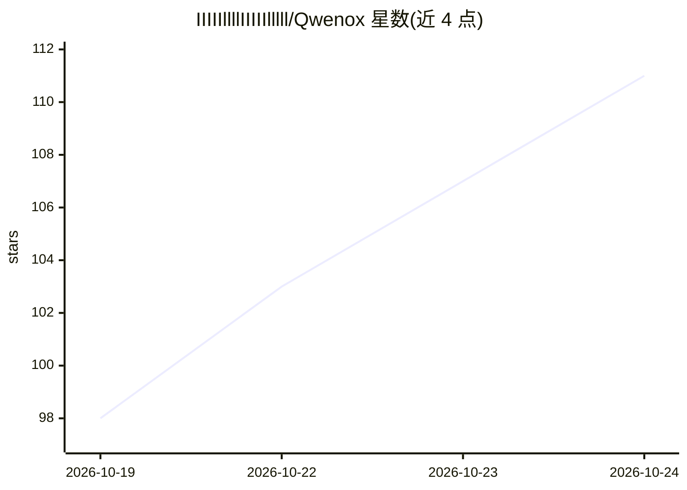

# IIIIIllllIIIIIlllll/Qwenox

⭐ 111 · C++ · AGPL-3.0 · 推送 2026-10-23 · [GitHub](https://github.com/IIIIIllllIIIIIlllll/Qwenox) · 个人维护 · 中文 README

**在 AMD Strix Halo 128GB APU 上本地运行 Qwen3.8-Flash-Next 的推理引擎**

面向 AMD Ryzen AI Max+ 395（gfx1151，128 GB 统一内存 APU）的本地推理引擎，仅支持部署 Qwen3.8-Flash-Next（177B MoE）。支持 hgn v2 与 GGUF（unsloth）两种权重来源，Linux 需 ROCm/HIP 编译，Windows 只需 AMD 显卡驱动（BIOS 划分 96 GiB 显存）。对外提供 OpenAI 兼容 API 与 Anthropic Messages API（流式、工具调用、图片输入）及网页控制台。关键机制：PLE n-gram 表留磁盘按需读取、ngram+MTP 投机解码、分页 KV 页池与两级 prompt 缓存避免重复 prefill、1–8 路并发。AGPL-3.0，声明仅供参考学习。给需要在 Strix Halo 硬件上本地部署该模型的开发者使用。

## 筛选速览

| 维度 | 判定 | 备注 |
|---|---|---|
| AI 角色 | `ai-ecosystem` | LLM/agent 周边工具 |
| 许可风险 | `viral` | AGPL-3.0 |
| 部署形态 | `desktop` | 安装包/桌面程序 |
| 模型依赖 | — | README 未给出锁定关系 |
| 硬件要求 | `gpu-24g` | |
| 安装摩擦 | `medium` | 含编译或系统依赖之一 |
| 成熟度 | — | 结构信号不足 |

## 能力要点

- 为 AMD Strix Halo（gfx1151，128 GB 统一内存）定制，Linux/Windows 同一份源码
- ngram 起草 + MTP 草稿头的投机解码，默认开启
- PLE n-gram 表留磁盘按需读取，常驻权重 60–77 GiB，支持 256K（YaRN 可 512K）上下文
- 分页 KV 页池 + 消息级检查点与 SSD 快照，多轮/编辑重发不重复 prefill

## 适用场景

- 在 Ryzen AI Max+ 395 小主机上本地跑 Qwen3.8-Flash-Next，通过 OpenAI 兼容 API 供其他应用调用
- 多轮对话与长文档场景下复用已算过的 prefill，减少等待
- Windows 上通过托盘程序与网页控制台管理引擎启停与配置

## 场景标签

`推理引擎` · 领域:训练与推理

## 证据(README 行号)

> L7: Qwenox 是 Qwen3.8-Flash-Next（177B MoE，qwen4_exp 架构）的本地推理引擎，为 AMD Strix Halo
> L8: （Ryzen AI Max+ 395，gfx1151）这类 128 GB 统一内存的 APU 编写，Linux 和 Windows 都能运行。
> L9: 对外提供 OpenAI 兼容 API 和 Anthropic Messages API（流式输出、工具调用、图片输入）以及网页控制台。

## 星数曲线

2026-10-19 98 → 2026-10-24 111（+13）

---
*卡片 v1 · prompt 1.4 · 生成 2026-10-23 · 置信度 mid · 依据 README sha `00fc7e25e495` · [字段定义](../../DATASET.md)*
