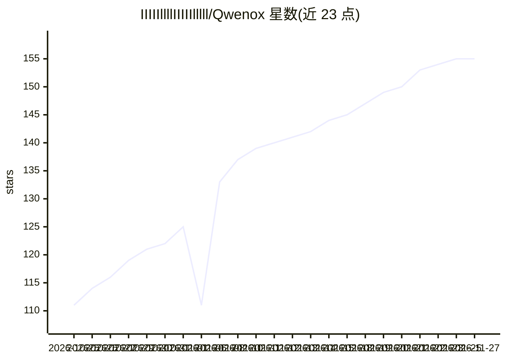

# IIIIIllllIIIIIlllll/Qwenox

⭐ 155 · C++ · AGPL-3.0 · 推送 2026-11-26 · [GitHub](https://github.com/IIIIIllllIIIIIlllll/Qwenox) · 个人维护 · 中文 README

**面向 AMD Strix Halo 395 APU 的 Qwen3.8-Flash-Next 本地推理引擎**

为 128 GB 统一内存的 AMD gfx1151 APU 编写的本地推理引擎，只支持部署 Qwen3.8-Flash-Next（177B MoE）。对外提供 OpenAI 兼容 API、Anthropic Messages API 与网页控制台。关键机制：路由专家 4-bit 加载、PLE n-gram 表驻磁盘按需读取、ngram+MTP 投机解码、分页 KV 池与两级 prompt 缓存。Linux 需 ROCm 编译，Windows 只需显卡驱动；支持 1–8 路并发，最大 256K 上下文（YaRN 可到 512K）。项目声明仅供参考学习。

## 筛选速览

| 维度 | 判定 | 备注 |
|---|---|---|
| AI 角色 | `ai-ecosystem` | LLM/agent 周边工具 |
| 许可风险 | `viral` | AGPL-3.0 |
| 部署形态 | `desktop` | 安装包/桌面程序 |
| 模型依赖 | — | README 未给出锁定关系 |
| 硬件要求 | — | 无带数字的原话,不猜 |
| 安装摩擦 | `medium` | 含编译或系统依赖之一 |
| 成熟度 | — | 结构信号不足 |

## 能力要点

- OpenAI 兼容与 Anthropic Messages API，支持流式、工具调用、图片输入
- 投机解码（ngram 起草 + MTP 兜底），greedy 逐位校验保证分布一致
- PLE n-gram 表留磁盘按需读取，常驻权重 60–77 GiB
- 1–8 路并发共享 KV 页池，256K 上下文，YaRN 可扩至 512K

## 适用场景

- 在 Strix Halo APU 上离线部署本地大模型 API 服务
- 给本地开发工具接 OpenAI 兼容端点跑代码任务
- 单机多路并发推理的后台任务场景

## 场景标签

`推理引擎` · 领域:训练与推理

## 证据(README 行号)

> L7: Qwenox 是 Qwen3.8-Flash-Next（177B MoE，qwen4_exp 架构）的本地推理引擎，为 AMD Strix Halo
> L9: 对外提供 OpenAI 兼容 API 和 Anthropic Messages API（流式输出、工具调用、图片输入）以及网页控制台。
> L164: 要求：ROCm（HIP 7.x 及以上），GPU 为 gfx1151，可用内存 ≥ 100 GiB。编译依赖 rocBLAS、hipBLASLt、

## 星数曲线

2026-10-25 111 → 2026-11-27 155（+44）

---
*卡片 v1 · prompt 1.4 · 生成 2026-11-27 · 置信度 mid · 依据 README sha `8aef17afe191` · [字段定义](../../DATASET.md)*
