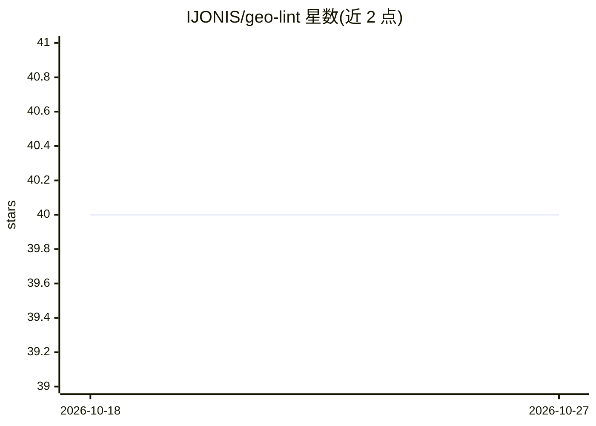

# IJONIS/geo-lint

⭐ 40 · TypeScript · MIT · 推送 2026-03-19 · [GitHub](https://github.com/IJONIS/geo-lint) · [官网](https://ijonis.com) · 个人维护

**面向 AI agent 的 GEO/SEO 内容检查器（97 条规则，可自动修复循环）**

开源的 GEO（Generative Engine Optimization）linter，对 Markdown/MDX 等内容执行 97 条规则检查：36 GEO、34 SEO、14 内容质量、10 技术、3 i18n，输出确定性结果与人类/JSON 双格式。设计为 agent-first：AI agent 读取 JSON 违规项及 suggestion 字段修复内容并重跑至零违规；提供 Claude Code skill（含 /geo-lint 与 /content-creator 命令）、CLI 与编程 API，支持自定义适配器接入 Astro/HTML/CMS。需 Node.js >= 18。

## 筛选速览

| 维度 | 判定 | 备注 |
|---|---|---|
| AI 角色 | `ai-ecosystem` | LLM/agent 周边工具 |
| 许可风险 | `permissive` | MIT |
| 部署形态 | `library` | 以包/库形式分发 |
| 模型依赖 | — | README 未给出锁定关系 |
| 硬件要求 | — | 无带数字的原话,不猜 |
| 安装摩擦 | `low` | 无编译、无系统依赖或容器化 |
| 成熟度 | — | 结构信号不足 |

## 能力要点

- 97 条规则覆盖 GEO/SEO/内容质量/技术/i18n
- 确定性 lint-fix 循环：JSON 违规输出 + suggestion/fixStrategy 字段供 agent 自动修复
- Claude Code skill 一键安装，含并行 subagent 的 audit 与内容创作流水线
- 自定义适配器扩展到 Astro/HTML/CMS，零 peer 依赖

## 适用场景

- 让 Claude Code 等 agent 自动扫描并修复整站内容的 GEO/SEO 违规
- 在 CI 中对内容做确定性的 GEO/SEO 质量门禁
- 用 /content-creator 生成并通过全部规则校验的内容

## 场景标签

 · 领域:内容工程/GEO-SEO 工具

## 证据(README 行号)

> L30: The skill runs an autonomous lint-fix loop: scan your content, read structured violations, fix them using each viol

## 星数曲线

2026-10-18 40 → 2026-10-27 40（+0）

---
*卡片 v1 · prompt 1.4 · 生成 2026-10-25 · 置信度 high · 依据 README sha `f6925171ffc2` · [字段定义](../../DATASET.md)*
