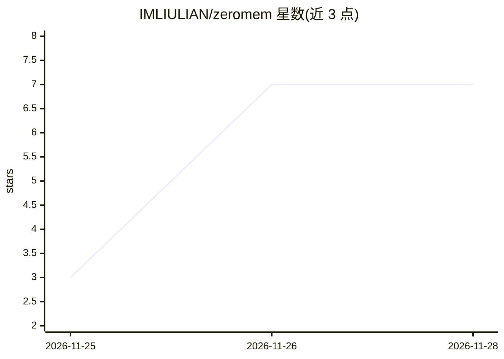

# IMLIULIAN/zeromem

⭐ 7 · Python · NOASSERTION · 推送 2026-11-27 · [GitHub](https://github.com/IMLIULIAN/zeromem) · 个人维护 · 中文 README

**面向 Qwen3.5-4B-Memory-V2 的零依赖本地 LLM 记忆引擎**

ZeroMem 是一个仅依赖 Python 3.9+ 标准库的本地记忆引擎，为开源模型 Qwen3.5-4B-Memory-V2 提供写入与检索：单个 SQLite 文件配合双轨 FTS5 索引（事实+原文），不引入向量库与 Embedding 模型。写入阶段由本地 4B 模型完成事实抽取与写前审校，入库前对常见密钥自动脱敏为 [REDACTED]。提供两种使用方案：CLI/Python SDK 单次检索预注，或 MCP 4 工具接入 7 款主流 Agent 客户端（修改配置前自动 .bak 备份）；附带基于 tkinter 的原生暗色桌面工作台，支持本地检索、原文溯源与图形化接入管理。运行需 Python 3.9+ 与 Ollama。

## 筛选速览

| 维度 | 判定 | 备注 |
|---|---|---|
| AI 角色 | `ai-ecosystem` | LLM/agent 周边工具 |
| 许可风险 | `none` | NOASSERTION |
| 部署形态 | `library` | 以包/库形式分发 |
| 模型依赖 | local-ok | 支持本地模型 |
| 硬件要求 | `gpu-8g` | |
| 安装摩擦 | `low` | 无编译、无系统依赖或容器化 |
| 成熟度 | — | 结构信号不足 |

## 能力要点

- 零第三方 Python 依赖，单 SQLite 文件 + 事实/原文双轨 FTS5 检索
- 写入阶段本地 4B 模型抽取与写前审校，不消耗云端 API，密钥自动脱敏
- MCP 4 工具（remember/recall/stats/delete）一键接入 7 款 Agent 客户端
- tkinter 原生暗色桌面工作台，原文证据溯源与 Agent 图形化管理

## 适用场景

- 给本地 4B 模型搭建不依赖云端的长期记忆
- 让 Claude Desktop / Cursor 等 Agent 检索本地工程文档记忆
- 希望在 API 调用前预注检索结果以减少 Token 消耗
- 处理含密钥的文档时要求入库前自动脱敏

## 场景标签

`Agent 记忆` · 领域:Agent 开发

## 证据(README 行号)

> L8: 项目围绕尽量简单的本地部署做了四项克制取舍：**无第三方 Python 依赖**（仅用 Python 3.9+ 标准库，含 MCP stdio 服务）、**无外部向量库与 Embedding 模型**（单个 SQLite 文件 + 
> L47: |**接入形态**|CLI 命令行 / 5 行 Python SDK 单次预注|零依赖 MCP 4 工具 + 7 款主流 Agent 接入 + 并行拆查提示词|
> L106: ZeroMem MCP 服务端兼容 `NDJSON` 与 `Content-Length` 双帧协议，提供 **`memory_remember` / `memory_recall` / `memory_stats` / `me

## 星数曲线

2026-11-25 3 → 2026-11-28 7（+4）

---
*卡片 v1 · prompt 1.4 · 生成 2026-11-24 · 置信度 high · 依据 README sha `365a8f8aa8e5` · [字段定义](../../DATASET.md)*
