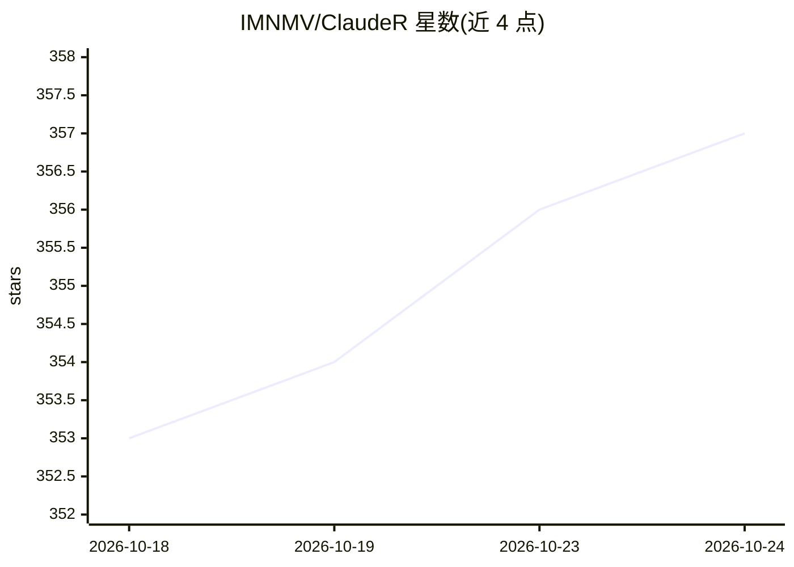

# IMNMV/ClaudeR

⭐ 358 · Python · NOASSERTION · 推送 2026-09-30 · [GitHub](https://github.com/IMNMV/ClaudeR) · 个人维护

**把 R/Python 会话接入 Claude Code 等 LLM agent 的 MCP 工具**

通过 MCP 将 Claude Code、Codex 等 LLM agent 连接到用户正在使用的 R 或 Python 会话（RStudio/Positron）：agent 在数据所在环境运行代码、查看绘图、读取对象、编辑打开的文件。支持多 agent 共享或隔离会话、协调消息、控制台日志与 41 个可配置工具；内置论文审计流程（Reviewer Zero 五遍协议）、系统综述筛选、模拟基金评审与审稿回复等科研工作流。R 包经 devtools 从 GitHub 安装，配套 Python 包发布于 PyPI。

## 筛选速览

| 维度 | 判定 | 备注 |
|---|---|---|
| AI 角色 | `ai-ecosystem` | LLM/agent 周边工具 |
| 许可风险 | `permissive` | NOASSERTION |
| 部署形态 | `library` | 以包/库形式分发 |
| 模型依赖 | locked-api |  |
| 硬件要求 | — | 无带数字的原话,不猜 |
| 安装摩擦 | `low` | 无编译、无系统依赖或容器化 |
| 成熟度 | — | 结构信号不足 |

## 能力要点

- MCP 连接活动 R/Python 会话，agent 可运行代码、读对象、编辑编辑器文件
- 多 agent 共享或并行隔离会话与协调消息机制
- Reviewer Zero 论文审计（含内容推理 Pass 5）与数值/引用核验工具
- 系统综述双筛选、模拟基金评审、审稿回复等科研工作流

## 适用场景

- 在 RStudio 中让 Claude Code 直接分析我已清洗的数据与模型
- 多个 agent（如 Codex+Claude Code）分工协作完成分析任务
- 对论文手稿做数值、引用与内容推理的自动审计
- 用两个不同模型家族的 AI 筛选系统综述文献并计算一致性

## 场景标签

`多智能体` `科研工具` `数据分析` · 领域:Agent 开发

## 证据(README 行号)

> L4:  Connect a live R or Python session, in RStudio or Positron, to Claude Code, Codex, or any MCP-based LLM agent. For 
> L17: **ClaudeR** connects MCP-configured LLM agents, like Claude Code or Codex, to the R session you are already working

## 星数曲线

2026-10-18 353 → 2026-10-24 357（+4）

---
*卡片 v1 · prompt 1.4 · 生成 2026-10-21 · 置信度 high · 依据 README sha `0fdeb6ffc642` · [字段定义](../../DATASET.md)*
