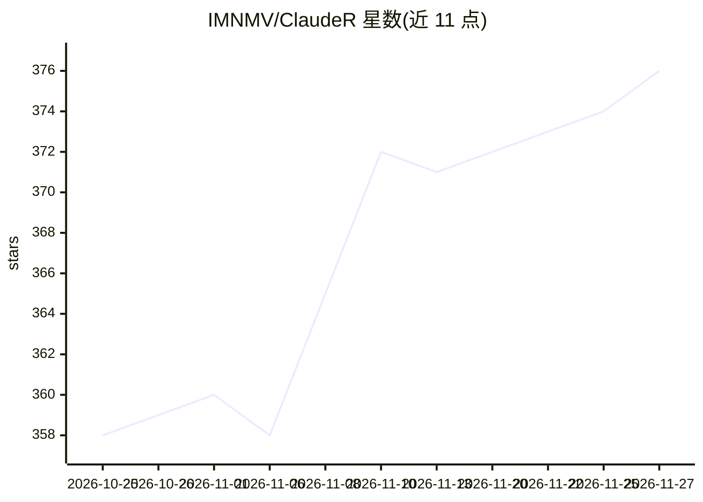

# IMNMV/ClaudeR

⭐ 376 · Python · NOASSERTION · 推送 2026-11-19 · [GitHub](https://github.com/IMNMV/ClaudeR) · 个人维护

**把 RStudio/Positron 的 R/Python 会话接入 MCP LLM agent 的桥接服务器**

ClaudeR 通过 MCP 协议把 Claude Code、Codex 等 LLM agent 连接到用户正在使用的 R 会话（配套 Python 包连接 Python 会话）：agent 在用户数据与模型所在环境中运行代码、查看图表、读取环境对象、编辑打开的文件。支持多 agent 共享或隔离会话、消息板协调、后台任务与唤醒机制、批量标注任务（run_annotation_job）、手稿审计，共 41 个工具。R 包经 GitHub 安装，MCP 服务可用 uvx 零配置启动；支持 RStudio、Positron 及终端/集群 R。

## 筛选速览

| 维度 | 判定 | 备注 |
|---|---|---|
| AI 角色 | `ai-ecosystem` | LLM/agent 周边工具 |
| 许可风险 | `permissive` | NOASSERTION |
| 部署形态 | `library` | 以包/库形式分发 |
| 模型依赖 | — | README 未给出锁定关系 |
| 硬件要求 | — | 无带数字的原话,不猜 |
| 安装摩擦 | `low` | 无编译、无系统依赖或容器化 |
| 成熟度 | — | 结构信号不足 |

## 能力要点

- 多 agent 编排：多 agent 共享一个会话分工，或并行独立会话互不干扰
- 41 个 MCP 工具，可按组隐藏以减少每次请求的 schema 开销
- run_annotation_job 批量标注：空文件夹/空系统提示调用，断点续跑
- 支持 RStudio、Positron、终端 R、tmux、ssh 集群与 Rscript

## 适用场景

- 让 Claude Code 直接在我的 R 数据和模型上做交互式分析
- 多个 agent 分工协作同一数据项目
- 用 CLI agent 批量标注数据行并保留原始回复记录
- 在集群或 tmux 中无 RStudio 环境下接入 agent

## 场景标签

`编码 Agent` `数据分析` `多智能体` · 领域:Agent 开发

## 证据(README 行号)

> L4:  Connect a live R or Python session, in RStudio or Positron, to Claude Code, Codex, or any MCP-based LLM agent. For 
> L17: **ClaudeR** connects MCP-configured LLM agents, like Claude Code or Codex, to the R session you are already working

## 星数曲线

2026-10-25 358 → 2026-11-27 376（+18）

---
*卡片 v1 · prompt 1.4 · 生成 2026-11-25 · 置信度 high · 依据 README sha `ed9d2537672b` · [字段定义](../../DATASET.md)*
