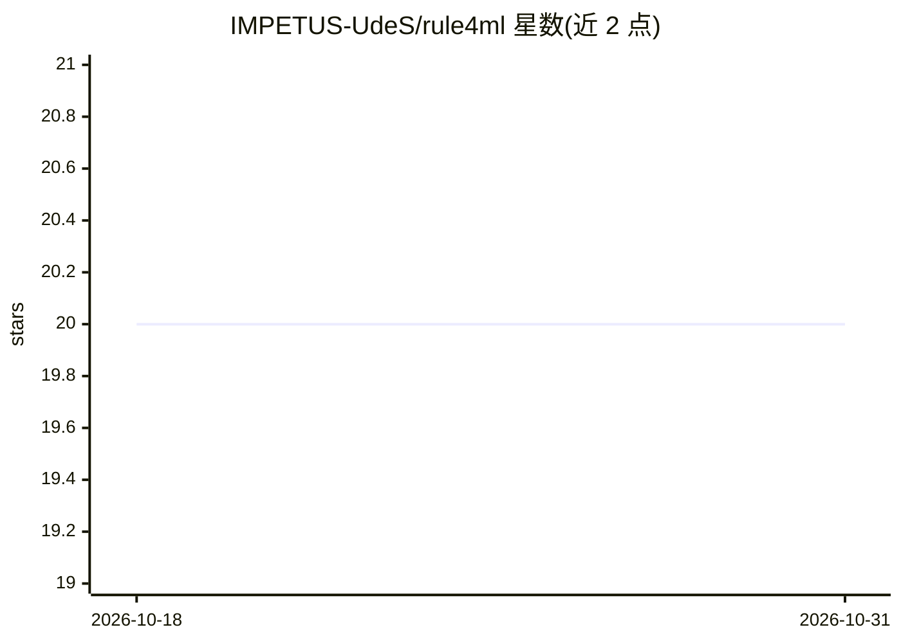

# IMPETUS-UdeS/rule4ml

⭐ 20 · Python · GPL-3.0 · 推送 2026-04-11 · [GitHub](https://github.com/IMPETUS-UdeS/rule4ml) · 组织维护

**为 FPGA 上的 ML 模型预测资源占用与推理延迟的工具**

面向 FPGA 部署机器学习模型的预综合估算工具：读取 Keras 或 PyTorch 模型，基于预训练的代理回归模型输出 BRAM/DSP/FF/LUT 资源占用与延迟（时钟周期）估算，覆盖多种综合配置。提供预训练估算器，也支持生成合成数据集并训练自有序预测器（data_gen 为可选安装）。限制：仅支持 Dense/ReLU/Tanh/Sigmoid/Softmax/BatchNorm/Add/Concatenate/Dropout 等特定层，且受 clock_period=10ns、io_parallel 等综合参数约束。以 pip 包形式提供。

## 筛选速览

| 维度 | 判定 | 备注 |
|---|---|---|
| AI 角色 | `ai-native` | 本体是模型或模型工具 |
| 许可风险 | `viral` | GPL-3.0 |
| 部署形态 | `library` | 以包/库形式分发 |
| 模型依赖 | — | README 未给出锁定关系 |
| 硬件要求 | — | 无带数字的原话,不猜 |
| 安装摩擦 | `low` | 无编译、无系统依赖或容器化 |
| 成熟度 | — | 结构信号不足 |

## 能力要点

- 预综合估算 FPGA 资源（BRAM/DSP/FF/LUT）与推理延迟
- 支持 Keras 与 PyTorch 模型输入
- 提供预训练估算器，也支持生成合成数据并训练自定义预测器
- 训练数据集公开托管于 Borealis 与 Hugging Face

## 适用场景

- 在 FPGA 综合前快速估算神经网络资源占用与延迟
- 探索不同综合配置对 FPGA 部署的影响
- 为 hls4ml 工作流提供快速的设计空间探索

## 场景标签

 · 领域:FPGA/机器学习部署工具

## 证据(README 行号)

> L6: `rule4ml` is a tool designed for pre-synthesis estimation of FPGA resource utilization and inference latency for mac
> L365: In their current iteration, the predictors can process Keras or PyTorch models to generate FPGA resources (**BRAM*

## 星数曲线

2026-10-18 20 → 2026-10-31 20（+0）

---
*卡片 v1 · prompt 1.4 · 生成 2026-10-28 · 置信度 high · 依据 README sha `955b180767dd` · [字段定义](../../DATASET.md)*
