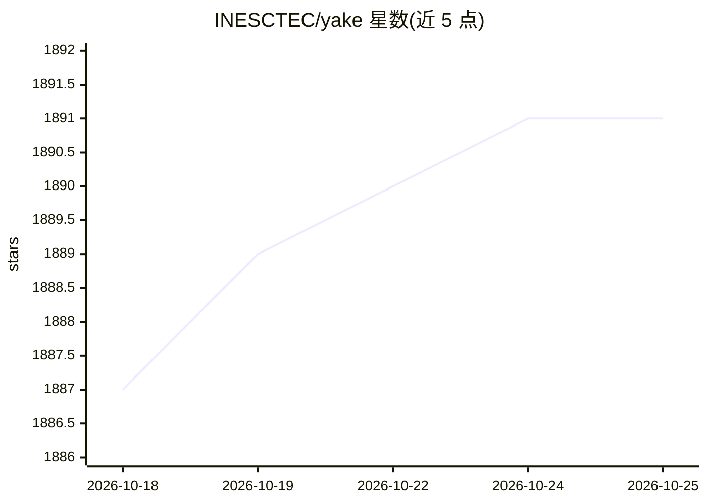

# INESCTEC/yake

⭐ 1,891 · Jupyter Notebook · NOASSERTION · 推送 2026-02-11 · [GitHub](https://github.com/INESCTEC/yake) · [官网](https://inesctec.github.io/yake) · 组织维护

**无监督单文档关键词抽取库，免训练免语料**

基于文本统计特征的无监督关键词抽取方法：从单篇文档中选出最重要关键词并输出相关性得分（分值越低越相关），无需训练、外部语料或词典，与语言和领域无关。以 Python 库形式提供，支持 pip 安装，含命令行用法、多语言示例（如葡萄牙语）、关键词词形归并（v0.6.0+）与文本高亮功能。由 INESC TEC 研究机构维护，附 ECIR 2018 与 Information Sciences 论文引用信息，获 ECIR'18 最佳短论文奖。

## 筛选速览

| 维度 | 判定 | 备注 |
|---|---|---|
| AI 角色 | `ai-native` | 本体是模型或模型工具 |
| 许可风险 | `none` | NOASSERTION |
| 部署形态 | `library` | 以包/库形式分发 |
| 模型依赖 | — | README 未给出锁定关系 |
| 硬件要求 | — | 无带数字的原话,不猜 |
| 安装摩擦 | `low` | 无编译、无系统依赖或容器化 |
| 成熟度 | — | 结构信号不足 |

## 能力要点

- 无监督、无需训练/外部语料/词典
- 单文档、语言与领域无关
- 关键词词形归并（lemmatization，v0.6.0+）与文本高亮功能
- 提供命令行与 Python 两种使用方式

## 适用场景

- 从单篇文档快速抽取关键词
- 处理多语言、多领域文本的关键词提取
- 在流水线中用文本高亮标注关键词位置

## 场景标签

 · 领域:NLP/文本挖掘

## 证据(README 行号)

> L8: YAKE! is a lightweight unsupervised automatic keyword extraction method that uses text statistical features to selec
> L54: The lower the score, the more relevant the keyword is.

## 星数曲线

2026-10-18 1,887 → 2026-10-25 1,891（+4）

---
*卡片 v1 · prompt 1.4 · 生成 2026-10-21 · 置信度 high · 依据 README sha `925d58d91556` · [字段定义](../../DATASET.md)*
