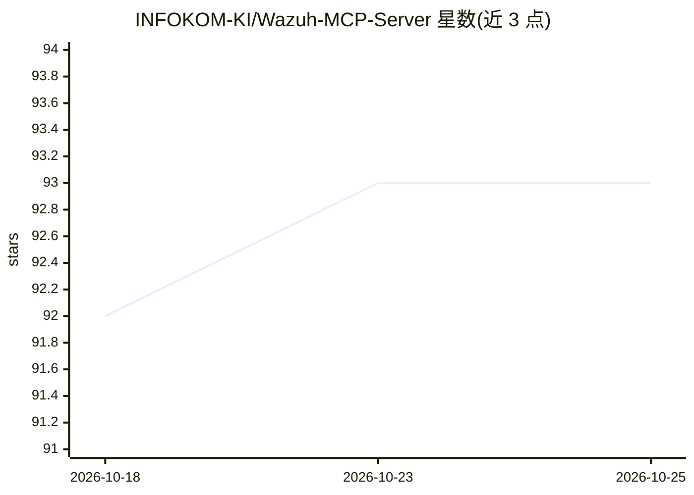

# INFOKOM-KI/Wazuh-MCP-Server

⭐ 93 · Python · BSD-3-Clause · 推送 2026-10-14 · [GitHub](https://github.com/INFOKOM-KI/Wazuh-MCP-Server) · 个人维护

**连接 Wazuh SIEM 的蓝队 MCP 服务器：让 AI 客户端做安全运营**

面向 Claude Desktop 等 MCP 客户端的防御端服务器，提供 160 个工具与 4 个资源（只读模式 134 个），覆盖 Wazuh SIEM 告警检索、多源威胁情报查询、MITRE ATT&CK 关联、攻击图、LangGraph 调查工作流、本地案例 RAG、主机取证及可选的 HDBSCAN 聚类与事件标注。工具调用经统一管道完成审计、脱敏与截断，出站 HTTP 使用按池熔断器；支持 stdio 与 streamable_http 两种传输，后者需 API key。凭据经环境变量配置，威胁情报 key 均可选。

## 筛选速览

| 维度 | 判定 | 备注 |
|---|---|---|
| AI 角色 | `ai-ecosystem` | LLM/agent 周边工具 |
| 许可风险 | `permissive` | BSD-3-Clause |
| 部署形态 | `None` |  |
| 模型依赖 | — | README 未给出锁定关系 |
| 硬件要求 | — | 无带数字的原话,不猜 |
| 安装摩擦 | `low` | 无编译、无系统依赖或容器化 |
| 成熟度 | — | 结构信号不足 |

## 能力要点

- 160 个工具覆盖 Wazuh Indexer/Manager API、威胁情报、MITRE 关联与主机取证
- 工具调用统一经过审计日志、数据脱敏与长度截断管道
- 出站 HTTP 按池熔断（连续 5 次失败断路，60 秒冷却）
- 可选本地案例 RAG、调查记忆与 HDBSCAN 告警聚类（均默认关闭）

## 适用场景

- 让 Claude 等 MCP 客户端直接查询和运营 Wazuh SIEM 告警
- SOC 分析师通过 AI 客户端做威胁情报查询与 ATT&CK 映射
- 对告警数据做脱敏后的自动化取证与关联调查

## 场景标签

`网络安全` · 领域:学习与行业

## 证据(README 行号)

> L9: A defensive MCP server for Claude Desktop / any MCP client, the blue-team counterpart to
> L10: offensive tooling. **160 tools + 4 resources** (134 when `WAZUH_READ_ONLY=true`) across Wazuh SIEM, multi-provider 

## 星数曲线

2026-10-18 92 → 2026-10-25 93（+1）

---
*卡片 v1 · prompt 1.4 · 生成 2026-10-24 · 置信度 high · 依据 README sha `970a4cc79aeb` · [字段定义](../../DATASET.md)*
