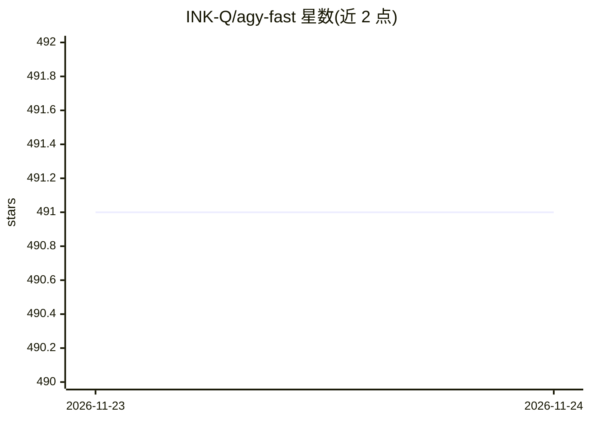

# INK-Q/agy-fast

⭐ 791 · TypeScript · MIT · 推送 2026-11-23 · [GitHub](https://github.com/INK-Q/agy-fast) · 个人维护 · 中文 README

**为 Google Antigravity 加速 MCP 工具调用的本地插件**

面向 Google Antigravity（CLI/Desktop/IDE）的零依赖本地 MCP 插件：将高频搜索、多语言符号大纲、原子多文件编辑与构建/测试检查合并为批量本地调用，并在会话开始时注入一次工作区快照，以减少 LLM 轮次、计费配额与上传流量，且不改变原生 UI、diff、检查点与安全检查。基于对 55 个真实会话的实证分析设计，提供 5 个组合 MCP 工具与离线基准 CLI，可在本地复测个人会话数据。

## 筛选速览

| 维度 | 判定 | 备注 |
|---|---|---|
| AI 角色 | `ai-ecosystem` | LLM/agent 周边工具 |
| 许可风险 | `permissive` | MIT |
| 部署形态 | `library` | 以包/库形式分发 |
| 模型依赖 | — | README 未给出锁定关系 |
| 硬件要求 | — | 无带数字的原话,不猜 |
| 安装摩擦 | `low` | 无编译、无系统依赖或容器化 |
| 成熟度 | — | 结构信号不足 |

## 能力要点

- 5 个本地 Stdio MCP 组合工具：batch_search、quick_outline、read_slices、apply_edits、run_checks
- SessionStart 钩子注入 ≤1.5KB 工作区快照（约 35–50ms）
- 零运行时依赖的预构建 ESM 包，可选 ripgrep 加速并自动回退
- 提供离线 transcript 分析与前后 A/B 对比 CLI

## 适用场景

- 用 Antigravity 编码代理时减少工具调用轮次与等待时间
- 降低大上下文会话的 token 计费配额消耗
- 团队按仓库共享安装同一插件配置
- 在本地离线分析自己会话的耗时与配额数据

## 场景标签

`编码 Agent` · 领域:编码与开发

## 证据(README 行号)

> L18: **`agy-fast`** is a zero-dependency, policy-compliant local MCP plugin for **Google Antigravity** (CLI `agy`, Deskt
> L117: |**Local Stdio MCP Server**|`mcp_config.json` → `dist/mcp-server.mjs`|Persistent local process exposing 5 eagerly 
> L5: **Latency, Token-Quota & Tool-Call Accelerator Plugin for Google Antigravity**

## 星数曲线

2026-11-23 491 → 2026-11-24 491（+0）

---
*卡片 v1 · prompt 1.4 · 生成 2026-11-23 · 置信度 mid · 依据 README sha `2eea9f3f0489` · [字段定义](../../DATASET.md)*
