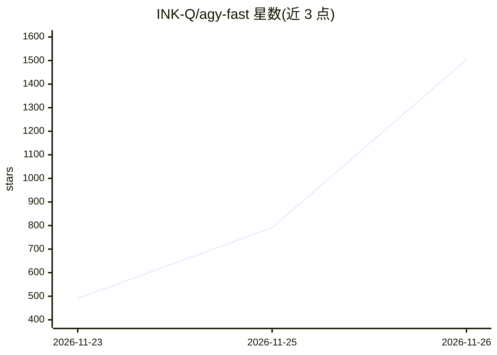

# INK-Q/agy-fast

⭐ 1,504 · TypeScript · MIT · 推送 2026-11-25 · [GitHub](https://github.com/INK-Q/agy-fast) · 个人维护 · 中文 README

**为 Google Antigravity 降延迟省 token 的本地 MCP 插件**

面向 Google Antigravity（CLI/Desktop 2.0/IDE）的非侵入式本地 MCP 插件：把高频搜索、多语言符号大纲、多文件原子编辑、构建/测试检查合并为批量本地调用，并在会话开始注入一次工作区快照，不改动 Antigravity 原生 UI、diff 视图与安全检查。零运行时依赖，需 Node.js ≥20，可选 ripgrep 加速搜索。README 基于 55 个真实会话的分析与 10 天转录对比给出各指标的降幅数据，并提供离线基准 CLI 供用户在本地转录上自行测量。

## 筛选速览

| 维度 | 判定 | 备注 |
|---|---|---|
| AI 角色 | `ai-ecosystem` | LLM/agent 周边工具 |
| 许可风险 | `permissive` | MIT |
| 部署形态 | `library` | 以包/库形式分发 |
| 模型依赖 | — | README 未给出锁定关系 |
| 硬件要求 | — | 无带数字的原话,不猜 |
| 安装摩擦 | `low` | 无编译、无系统依赖或容器化 |
| 成熟度 | — | 结构信号不足 |

## 能力要点

- 5 个 MCP 复合工具：batch_search（单次最多 20 查询）、quick_outline、apply_edits（单次最多 50 文件）、run_checks 等
- SessionStart 钩子在约 35–50 ms 内注入 ≤1.5 KB 工作区快照
- 工具返回强制 ≤8.8 KB UTF-8 内联上限，避免落盘溢出产生的额外轮次
- 支持一键脚本、本地克隆、agy plugin install、按仓库安装等多种安装方式

## 适用场景

- 在使用 Antigravity 编码时减少 LLM 轮次与计费 token 配额消耗
- 多文件批量编辑与构建/测试检查合并到单次调用中执行
- 在本地离线分析自己的会话转录，验证加速效果

## 场景标签

`编码 Agent` · 领域:编码与开发

## 证据(README 行号)

> L5: **Latency, Token-Quota & Tool-Call Accelerator Plugin for Google Antigravity**
> L18: **`agy-fast`** is a zero-dependency, policy-compliant local MCP plugin for **Google Antigravity** (CLI `agy`, Deskt

## 星数曲线

2026-11-23 491 → 2026-11-26 1,504（+1,013）

---
*卡片 v1 · prompt 1.4 · 生成 2026-11-25 · 置信度 mid · 依据 README sha `8f8cf2382e4d` · [字段定义](../../DATASET.md)*
