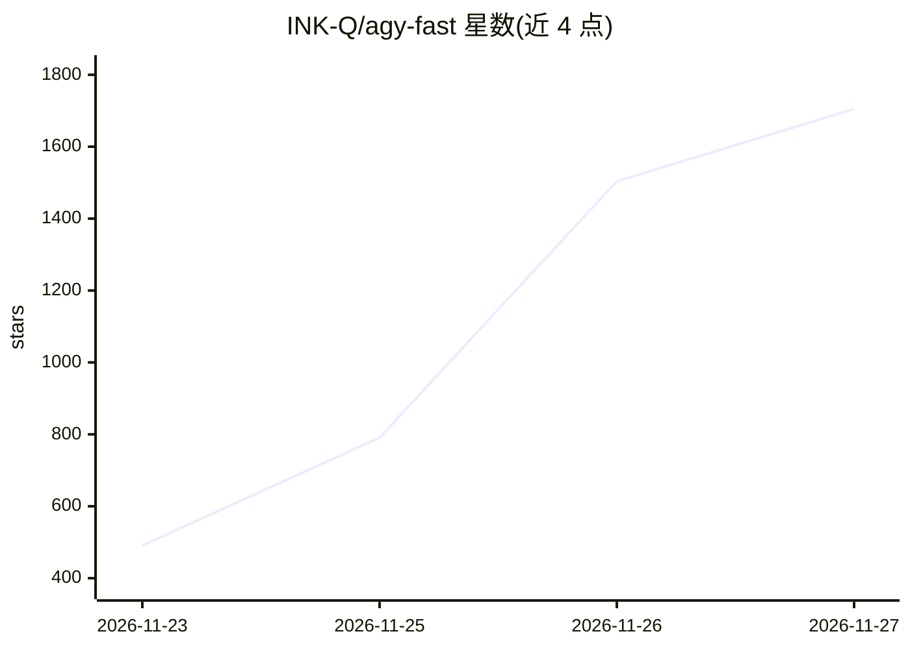

# INK-Q/agy-fast

⭐ 1,705 · TypeScript · MIT · 推送 2026-11-26 · [GitHub](https://github.com/INK-Q/agy-fast) · 个人维护 · 中文 README

**给 Google Antigravity 提速的本地 MCP 插件：减少回合数与 token 配额消耗**

面向 Google Antigravity（CLI `agy`、Desktop 2.0、IDE）的非侵入式本地 MCP 插件，将高频搜索、多语言符号大纲、多文件原子编辑、构建/测试检查合并为批量本地调用，并在每次会话注入一次工作区快照。作者基于 55 个真实会话（8,446 LLM 回合）的分析给出基准数据。零运行时依赖，需要 Node.js >= 20，ripgrep 可选；支持插件目录直装、npm/npx、git clone 及单仓库安装，亦可作为纯 MCP stdio 服务器挂载到第三方 MCP 宿主。

## 筛选速览

| 维度 | 判定 | 备注 |
|---|---|---|
| AI 角色 | `ai-ecosystem` | LLM/agent 周边工具 |
| 许可风险 | `permissive` | MIT |
| 部署形态 | `library` | 以包/库形式分发 |
| 模型依赖 | — | README 未给出锁定关系 |
| 硬件要求 | — | 无带数字的原话,不猜 |
| 安装摩擦 | `low` | 无编译、无系统依赖或容器化 |
| 成熟度 | — | 结构信号不足 |

## 能力要点

- 提供 5 个本地 MCP 复合工具：batch_search、quick_outline、read_slices、apply_edits、run_checks
- SessionStart 钩子在约 35–50 ms 内注入 ≤1.5 KB 工作区快照
- 支持作为纯 MCP stdio 服务器挂载到任意标准 MCP 宿主
- 内置离线 benchmark CLI 可在本地分析自己的 transcript

## 适用场景

- 使用 Antigravity 做编码时减少 agent 往返回合与等待时间
- 降低计费 token 配额与上传流量消耗
- 在团队仓库内通过单仓库安装共享同一插件配置
- 在第三方 MCP 宿主中挂载批量搜索与多文件编辑工具

## 场景标签

`编码 Agent` · 领域:编码与开发

## 证据(README 行号)

> L19: **`agy-fast`** is a zero-dependency, policy-compliant local MCP plugin for **Google Antigravity** (CLI `agy`, Deskt
> L135: |**Local Stdio MCP Server**|`mcp_config.json` → `dist/mcp-server.mjs`|Persistent local process exposing 5 eagerly 
> L63: #### Standalone Pure MCP Server (Any Standard MCP Host)

## 星数曲线

2026-11-23 491 → 2026-11-27 1,705（+1,214）

---
*卡片 v1 · prompt 1.4 · 生成 2026-11-27 · 置信度 high · 依据 README sha `a5c48db04bc6` · [字段定义](../../DATASET.md)*
