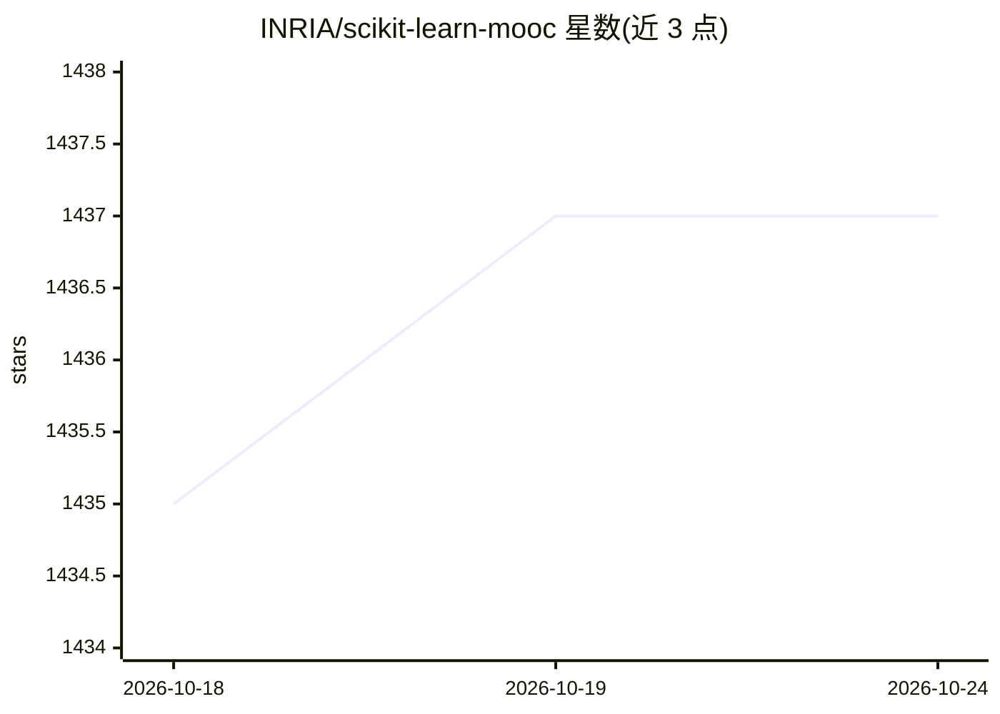

# INRIA/scikit-learn-mooc

⭐ 1,437 · Jupyter Notebook · CC-BY-4.0 · 推送 2026-10-13 · [GitHub](https://github.com/INRIA/scikit-learn-mooc) · [官网](https://inria.github.io/scikit-learn-mooc) · 组织维护

**scikit-learn 机器学习公开课（MOOC）的课程源码仓库**

INRIA 维护的 Python 机器学习 MOOC 的课程材料源码仓库，对应 FUN-MOOC 平台上的免费课程；包含可执行 notebook，可通过 Binder 在线运行、浏览 Jupyter Book 生成的静态站点，或按指引本地运行 notebook。注册完整课程可获得测验解答、可执行 notebook 与讨论论坛。内容以 CC-BY 许可发布，并提供 Zenodo DOI 供引用。本仓库为教学材料，非软件产品。

## 筛选速览

| 维度 | 判定 | 备注 |
|---|---|---|
| AI 角色 | `ai-knowledge` | 知识聚合/清单类 |
| 许可风险 | `viral` | CC-BY-4.0 |
| 部署形态 | `None` |  |
| 模型依赖 | — | README 未给出锁定关系 |
| 硬件要求 | — | 无带数字的原话,不猜 |
| 安装摩擦 | `low` | 无编译、无系统依赖或容器化 |
| 成熟度 | — | 结构信号不足 |

## 能力要点

- FUN-MOOC 平台免费课程，平台声明不将学生数据用于改进教学之外的目的
- 支持 Binder 在线启动 notebook 环境
- 课程静态站点由 Jupyter Book 生成，可在线浏览
- CC-BY 许可发布，提供 Zenodo DOI（10.5281/zenodo.7220306）

## 适用场景

- 系统学习 scikit-learn 机器学习方法
- 在线（Binder）或本地运行课程可执行 notebook
- 引用课程材料用于教学或研究

## 场景标签

`教程课程` · 领域:学习与行业

## 证据(README 行号)

> L3: This is the source code for the [Machine learning in Python with scikit-learn
> L4: MOOC](https://www.fun-mooc.fr/en/courses/machine-learning-python-scikit-learn).

## 星数曲线

2026-10-18 1,435 → 2026-10-24 1,437（+2）

---
*卡片 v1 · prompt 1.4 · 生成 2026-10-21 · 置信度 high · 依据 README sha `0ccc0813d275` · [字段定义](../../DATASET.md)*
