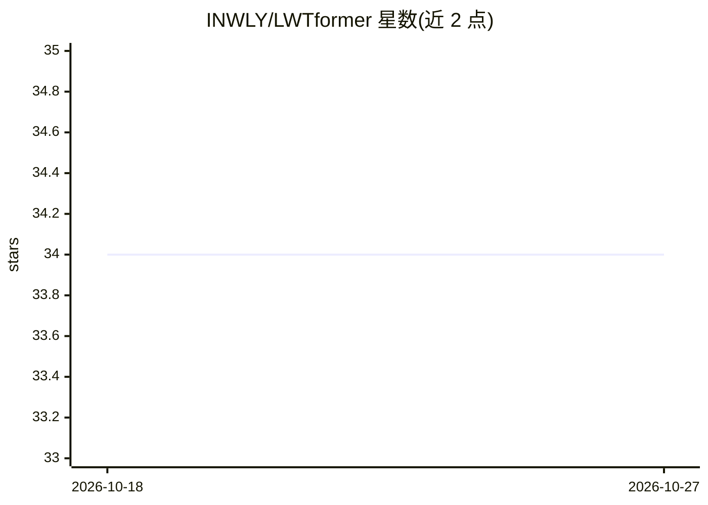

# INWLY/LWTformer

⭐ 34 · Python · NOASSERTION · 推送 2026-08-28 · [GitHub](https://github.com/INWLY/LWTformer) · 组织维护 · 中文 README

**古文字图像修复的可学习小波 Transformer（PyTorch 官方实现）**

CVPR 2026 Findings 论文 LWTformer 的官方 PyTorch 实现，面向甲骨文、战国楚简等古汉字图像的退化修复（腐蚀、磨损、断裂、噪声）。核心机制：可学习 2D 离散小波下采样模块 WaveDown 将图像分为低频结构与高频笔画细节，配合 Spatial-Enhanced Attention 与 WACGA 捕获细笔画与受损边缘。提供训练与推理脚本、两种架构规模（LWTformer-B/L）；许可证限定仅限非商业研究用途，WebUI 与预训练模块在 TODO 中未完成。

## 筛选速览

| 维度 | 判定 | 备注 |
|---|---|---|
| AI 角色 | `ai-native` | 本体是模型或模型工具 |
| 许可风险 | `none` | NOASSERTION |
| 部署形态 | `None` |  |
| 模型依赖 | — | README 未给出锁定关系 |
| 硬件要求 | — | 无带数字的原话,不猜 |
| 安装摩擦 | `medium` | 含编译或系统依赖之一 |
| 成熟度 | — | 结构信号不足 |

## 能力要点

- 可学习 2D-DWT 下采样模块 WaveDown 分离低频结构与高频笔画
- SEA 与 WACGA 模块捕获细笔画与受损边缘
- 提供训练/推理脚本与 LWTformer-B/L 两种架构
- 在甲骨文与 WSC41K 数据集上实验，含真实湖北楚简泛化测试

## 适用场景

- 修复甲骨文、楚简等古汉字退化图像
- 在自己的古文字数据集上训练修复模型
- 复现论文的基准实验与对比结果

## 场景标签

`图像视频处理` · 领域:感知与多模态

## 证据(README 行号)

> L1: # LWTformer: A Detail-Aware, Learnable Wavelet-Transformer for Ancient Chinese Character Image Restoration
> L13: > To address these issues, we propose LWTformer, a novel architecture integrating learnable 2D Discrete Wavelet Tra

## 星数曲线

2026-10-18 34 → 2026-10-27 34（+0）

---
*卡片 v1 · prompt 1.4 · 生成 2026-10-25 · 置信度 high · 依据 README sha `30973be7cff5` · [字段定义](../../DATASET.md)*
