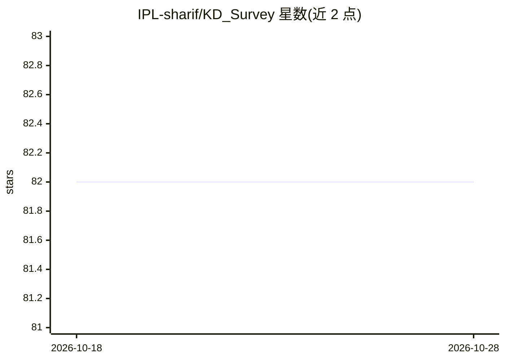

# IPL-sharif/KD_Survey

⭐ 82 · 推送 2026-06-08 · [GitHub](https://github.com/IPL-sharif/KD_Survey) · 组织维护

**知识蒸馏综述论文的配套资源仓库**

TMLR 2025 综述论文《A Comprehensive Survey on Knowledge Distillation》的配套仓库：论文综述知识蒸馏的蒸馏来源（logit/feature/similarity）、蒸馏方案（offline/online/self）、蒸馏算法、按模态蒸馏（3D、文本、语音、视频等）及应用（LLM、基础模型、扩散模型、视觉识别等），并讨论现有挑战与未来方向。仓库还列举 6 篇既有 KD 综述作为对照，并提供 BibTeX 引用条目。面向从事模型压缩与知识蒸馏研究的科研人员。

## 筛选速览

| 维度 | 判定 | 备注 |
|---|---|---|
| AI 角色 | `ai-knowledge` | 知识聚合/清单类 |
| 许可风险 | `none` | — |
| 部署形态 | `None` |  |
| 模型依赖 | — | README 未给出锁定关系 |
| 硬件要求 | — | 无带数字的原话,不猜 |
| 安装摩擦 | `low` | 无编译、无系统依赖或容器化 |
| 成熟度 | — | 结构信号不足 |

## 能力要点

- 覆盖蒸馏来源、方案、算法、模态与应用的多维度分类体系
- 包含扩散模型、3D 输入、基础模型、transformer 与 LLM 等近期子方向
- 列举 6 篇既有 KD 综述作为对照

## 适用场景

- 查找知识蒸馏各子方向的代表方法与分类
- 了解 KD 在 LLM 与基础模型上的最新进展
- 按论文分类体系检索相关研究工作

## 场景标签

`科研工具` `精选清单` · 领域:学习与行业

## 证据(README 行号)

> L4: This repository belongs to the paper: A Comprehensive Survey on Knowledge Distillation.
> L7: Deep Neural Networks (DNNs) have achieved notable performance in the fields of computer vision and natural language 

## 星数曲线

2026-10-18 82 → 2026-10-28 82（+0）

---
*卡片 v1 · prompt 1.4 · 生成 2026-10-24 · 置信度 high · 依据 README sha `bd7761a68d54` · [字段定义](../../DATASET.md)*
