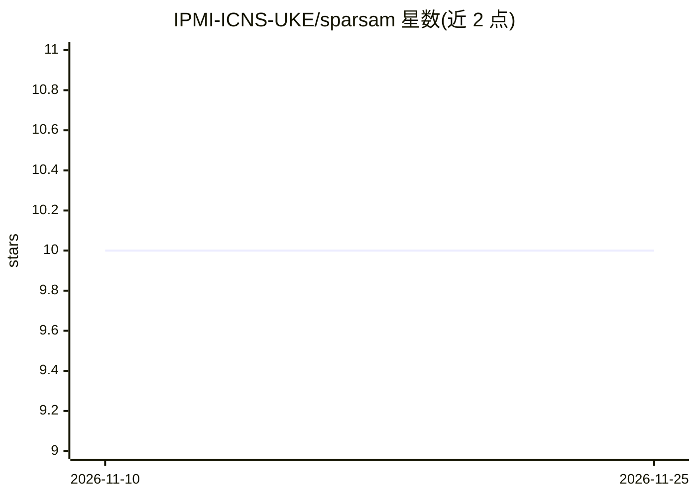

# IPMI-ICNS-UKE/sparsam

⭐ 10 · Python · MIT · 推送 2026-09-22 · [GitHub](https://github.com/IPMI-ICNS-UKE/sparsam) · 组织维护

**少标注医学影像分类的自监督学习研究代码库**

论文 Self-Supervision for Medical Image Classification 的配套代码与数据划分：提供 DINO 自监督算法的复现实现，结合 SVM 分类器在骨髓细胞、内窥镜、皮肤镜三类医学影像数据集上训练与评估；提供学生-教师训练类、标准化监督基线管线、全部数据集的训练-测试划分，XCiT small 预训练权重经 Zenodo 提供，并附复现论文结果的步骤与示例脚本。面向希望在自己的医学数据上应用并报告结果的研究者与从业者。

## 筛选速览

| 维度 | 判定 | 备注 |
|---|---|---|
| AI 角色 | `ai-native` | 本体是模型或模型工具 |
| 许可风险 | `permissive` | MIT |
| 部署形态 | `library` | 以包/库形式分发 |
| 模型依赖 | — | README 未给出锁定关系 |
| 硬件要求 | — | 无带数字的原话,不猜 |
| 安装摩擦 | `low` | 无编译、无系统依赖或容器化 |
| 成熟度 | — | 结构信号不足 |

## 能力要点

- 开箱即用的 DINO 算法复现实现
- 提供全部数据集的训练-测试划分与可复现结果
- 支持多架构的学生-教师训练自定义
- 预训练 XCiT small 权重通过 Zenodo 提供

## 适用场景

- 在标注样本稀缺的医学影像数据上训练分类模型
- 复现论文中的 SSL+SVM 实验结果
- 将 DINO 自监督流程适配到自有数据集

## 场景标签

`模型训练` `科研工具` · 领域:学习与行业

## 证据(README 行号)

> L5: This repository contains the code and data splits used in the experiments described in the publication titled "Self-
> L12: - Ready-to-use reimplementation of the DINO algorithm
> L51: For each data set, the trained XCiT small model weights are provided and can be used in the following way:

## 星数曲线

2026-11-10 10 → 2026-11-25 10（+0）

---
*卡片 v1 · prompt 1.4 · 生成 2026-11-20 · 置信度 high · 依据 README sha `42ba386203be` · [字段定义](../../DATASET.md)*
