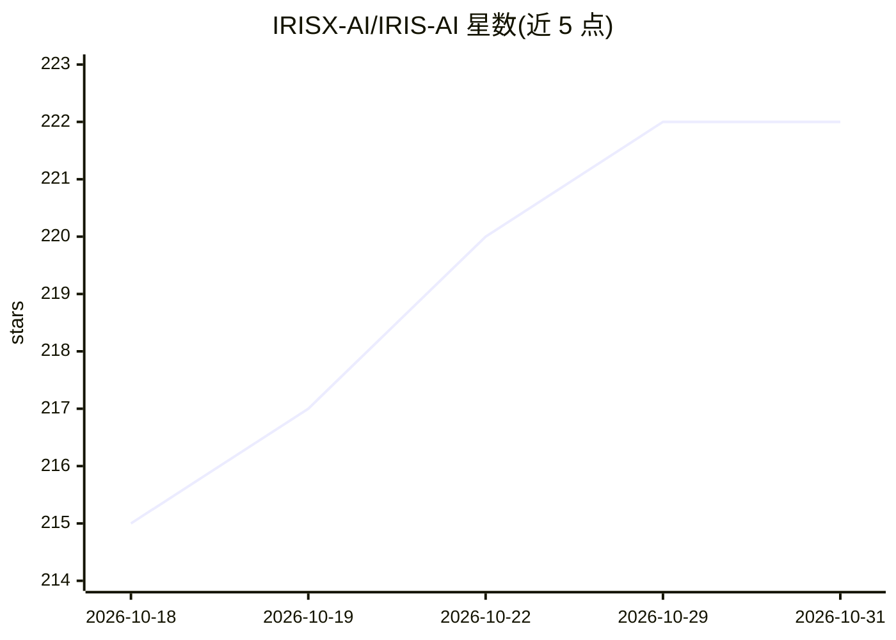

# IRISX-AI/IRIS-AI

⭐ 222 · TypeScript · NOASSERTION · 推送 2026-10-28 · [GitHub](https://github.com/IRISX-AI/IRIS-AI) · [官网](https://www.irisxai.in/) · 个人维护

**语音优先的桌面 AI 助手：用语音指挥执行系统操作**

基于 Electron 的桌面 AI 助手，通过 Gemini 3.1 Live API 与 WebRTC 实现实时双向语音交互，支持唤醒词启动。功能覆盖文件管理、终端执行、窗口/光标控制、本地向量检索与 RAG、Playwright 网页抓取、Gmail/WhatsApp 集成、ADB 安卓远程控制及图像与文档生成。采用 Open Core 模式：公开仓库含框架、UI 与基础设施，核心语音编排与工具执行逻辑不开源。免费层限每日 12 轮对话、5 次工具调用；1.7.0 之前版本已停止运行。

## 筛选速览

| 维度 | 判定 | 备注 |
|---|---|---|
| AI 角色 | `ai-native` | 本体是模型或模型工具 |
| 许可风险 | `none` | NOASSERTION |
| 部署形态 | `library` | 以包/库形式分发 |
| 模型依赖 | locked-api |  |
| 硬件要求 | — | 无带数字的原话,不猜 |
| 安装摩擦 | `low` | 无编译、无系统依赖或容器化 |
| 成熟度 | — | 结构信号不足 |

## 能力要点

- Gemini 3.1 Live API + WebRTC 实时双向语音，端到端延迟低于 500ms
- 覆盖文件/终端/窗口/系统设置的语音化桌面控制
- ADB 远程控制安卓设备（触控、文件传输、相机、APK 安装）
- 本地向量数据库索引与代码库 RAG 查询（Codebase Oracle）

## 适用场景

- 用语音命令操作桌面应用、文件与终端
- 语音驱动的自动化工作流与宏执行
- 远程控制安卓手机并传输文件
- 对本地代码库做语义检索与问答

## 场景标签

`AI 助手` `语音 Agent` `GUI 自动化` · 领域:效率与自动化

## 证据(README 行号)

> L29: A voice-first neural execution system powered by **Gemini 3.1 Live API** with real-time WebRTC audio, biometric sec
> L39: It is a **Voice-First Desktop AI Assistant** that executes real-world actions across your system, applications, and

## 星数曲线

2026-10-18 215 → 2026-10-31 222（+7）

---
*卡片 v1 · prompt 1.4 · 生成 2026-10-22 · 置信度 high · 依据 README sha `a4a8476a84a0` · [字段定义](../../DATASET.md)*
