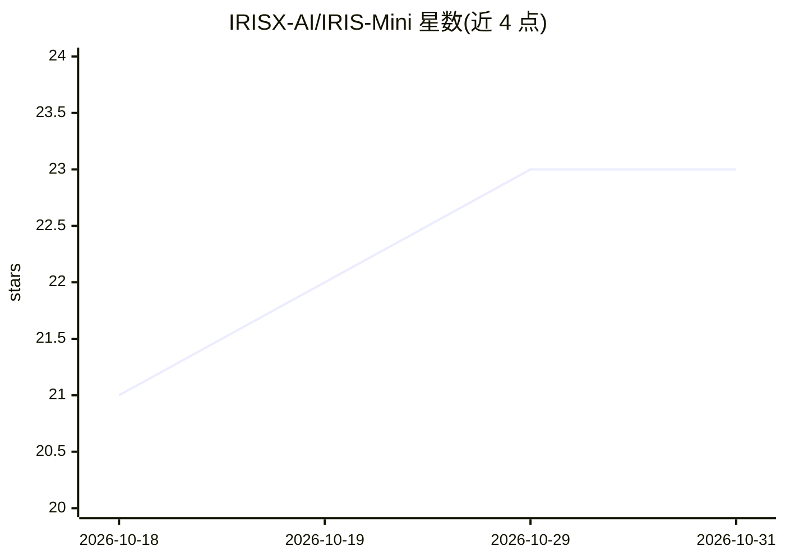

# IRISX-AI/IRIS-Mini

⭐ 23 · TypeScript · NOASSERTION · 推送 2026-10-26 · [GitHub](https://github.com/IRISX-AI/IRIS-Mini) · [官网](https://irisxai.in) · 个人维护

**基于 Gemini Live API 的桌面语音 AI 助手，带 CLI**

IRIS-MINI 是一个语音 AI 助手：调用 Google Gemini Live API 提供实时对话交互，支持 React/Three.js Web 界面与终端 CLI 两种使用方式。功能包括本地 Windows 应用管理、Google 网页搜索。需要用户提供 Gemini API Key，严格要求 Node.js v24+。提供三种安装路径：npm 全局安装 CLI、源码本地开发、docker-compose 容器部署（容器模式下 Windows 集成与麦克风访问不可用）。首次运行有交互式设置向导配置 API Key 与语音选择。

## 筛选速览

| 维度 | 判定 | 备注 |
|---|---|---|
| AI 角色 | `ai-native` | 本体是模型或模型工具 |
| 许可风险 | `none` | NOASSERTION |
| 部署形态 | `self-host` | docker 或自建部署 |
| 模型依赖 | — | README 未给出锁定关系 |
| 硬件要求 | — | 无带数字的原话,不猜 |
| 安装摩擦 | `low` | 无编译、无系统依赖或容器化 |
| 成熟度 | — | 结构信号不足 |

## 能力要点

- 基于 Google Gemini Live API 的实时语音对话
- React Web 界面与 CLI 双形态
- 本地 Windows 应用管理与 Google 搜索
- npm 全局安装、源码运行、Docker 三种部署方式

## 适用场景

- 在桌面通过语音与 AI 助手实时对话
- 在终端中通过 CLI 使用语音助手
- 在服务器/无头环境用 Docker 部署后端服务

## 场景标签

`语音 Agent` `AI 助手` · 领域:对话与助手

## 证据(README 行号)

> L11: **IRIS-MINI** is a production-grade, state-of-the-art Voice AI Assistant. Harnessing the power of the **Google Gemi
> L24: - 🎙️ **Advanced Voice AI**: Powered by Google Gemini Live API for real-time, low-latency, and highly intelligent co

## 星数曲线

2026-10-18 21 → 2026-10-31 23（+2）

---
*卡片 v1 · prompt 1.4 · 生成 2026-10-27 · 置信度 high · 依据 README sha `3597e95943f1` · [字段定义](../../DATASET.md)*
