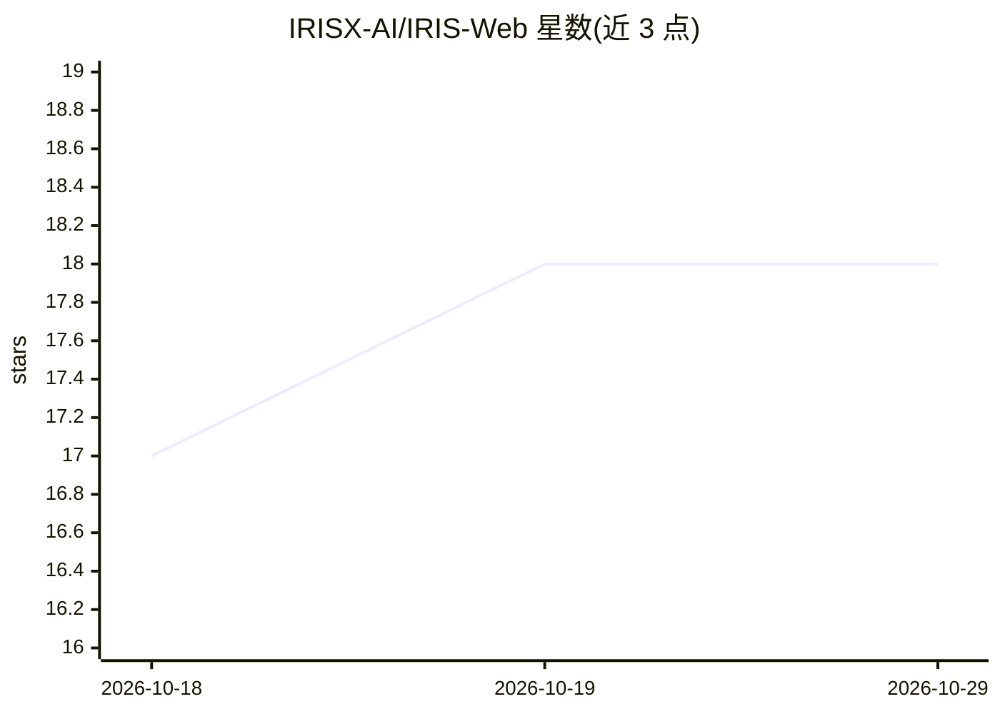

# IRISX-AI/IRIS-Web

⭐ 18 · TypeScript · NOASSERTION · 推送 2026-07-14 · [GitHub](https://github.com/IRISX-AI/IRIS-Web) · [官网](https://irisxai.in) · 组织维护

**语音优先的桌面 AI 助手，用语音指令执行系统与应用操作**

面向终端用户的语音优先桌面 AI 助手：通过 WebRTC 实时音频接入 Gemini Live API，以语音指令执行本机操作，覆盖应用启停、文件读写、终端执行、窗口与光标控制、屏幕 OCR、本地向量检索、Playwright 网页抓取、WhatsApp/Gmail 通信、ADB 远程控制 Android 设备及深度研究 RAG 等。采用 Open Core 模式：公开仓库仅含桌面框架、UI 与部分集成，核心语音编排引擎与工具执行逻辑为闭源私有组件；1.7.0 前的旧版本已停止工作，免费层每日限 12 轮对话与 5 次工具调用。

## 筛选速览

| 维度 | 判定 | 备注 |
|---|---|---|
| AI 角色 | `ai-native` | 本体是模型或模型工具 |
| 许可风险 | `none` | NOASSERTION |
| 部署形态 | `library` | 以包/库形式分发 |
| 模型依赖 | — | README 未给出锁定关系 |
| 硬件要求 | — | 无带数字的原话,不猜 |
| 安装摩擦 | `low` | 无编译、无系统依赖或容器化 |
| 成熟度 | — | 结构信号不足 |

## 能力要点

- WebRTC 实时双向语音，端到端延迟标称低于 500ms，唤醒词免手启动
- 语音驱动的系统级执行：文件、终端、窗口控制、屏幕 OCR 提取
- ADB 远程控制 Android 设备：触控、文件传输、硬件开关、拍照
- Open Core 模式：核心 agent 编排与工具执行逻辑闭源

## 适用场景

- 用语音免手操作桌面应用、文件与终端命令
- 让助手按语义索引并检索本地代码库与文档
- 通过语音远程操控 Android 手机并传输文件

## 场景标签

`语音 Agent` `AI 助手` `RAG` `GUI 自动化` · 领域:效率与自动化

## 证据(README 行号)

> L29: A voice-first neural execution system powered by **Gemini 3.1 Live API** with real-time WebRTC audio, biometric sec
> L39: It is a **Voice-First Desktop AI Assistant** that executes real-world actions across your system, applications, and

## 星数曲线

2026-10-18 17 → 2026-10-29 18（+1）

---
*卡片 v1 · prompt 1.4 · 生成 2026-10-29 · 置信度 high · 依据 README sha `7b3f1e79d2d8` · [字段定义](../../DATASET.md)*
