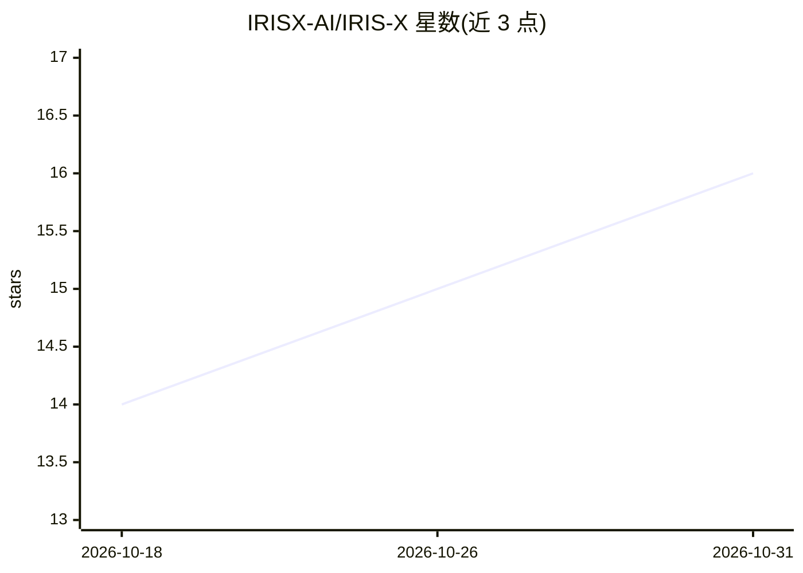

# IRISX-AI/IRIS-X

⭐ 16 · Kotlin · NOASSERTION · 推送 2026-10-17 · [GitHub](https://github.com/IRISX-AI/IRIS-X) · [官网](irisxai.in) · 组织维护

**面向 Android 的语音优先手机 AI 助手：说话即执行操作**

Android 移动应用，通过 Gemini 3.5 Flash Lite 的双向实时语音 WebSocket，以语音指令在手机上执行操作：接听/拒接来电与来电播报、读取并自动回复 WhatsApp/Instagram/Telegram/SMS 通知、控制 Spotify/YouTube 等媒体播放、打开应用与深链、开关手电筒与跳转设置、日历管理与记忆存储，并支持屏幕实时流式传输作为视觉上下文。采用 Open Core 模式：公开仓库仅含 UI 外壳（MIT），核心语音执行引擎私有，完整功能需购买 Mobile PRO License；用户需自带 Gemini API Key。提供官方 APK 下载。

## 筛选速览

| 维度 | 判定 | 备注 |
|---|---|---|
| AI 角色 | `ai-native` | 本体是模型或模型工具 |
| 许可风险 | `none` | NOASSERTION |
| 部署形态 | `None` |  |
| 模型依赖 | — | README 未给出锁定关系 |
| 硬件要求 | — | 无带数字的原话,不猜 |
| 安装摩擦 | `low` | 无编译、无系统依赖或容器化 |
| 成熟度 | — | 结构信号不足 |

## 能力要点

- Gemini Live WebSocket 双向实时语音流，含回声消除与实时事件注入
- 通话管理、通知自动回复、系统级媒体控制、硬件开关等原生工具集
- 实时屏幕捕获流式传输给 AI 提供视觉上下文
- BYOK：Gemini API Key 加密存储于本机，声明零数据记录

## 适用场景

- 免手操作接听/拒接来电并语音播报来电者
- 让 AI 读取并自动回复即时通讯通知
- 用语音控制媒体播放、开关硬件与打开应用
- 语音管理日程并让助手记住个人事项

## 场景标签

`AI 助手` `语音 Agent` · 领域:对话与助手

## 证据(README 行号)

> L29: A voice-first mobile execution assistant powered by **Gemini 3.5 Flash Lite** & **Gemini Live WebSockets** (`wss://
> L39: It is a **Voice-First Mobile AI Assistant** built on the powerful IRIS-AI Voice Engine. It listens to your spoken c

## 星数曲线

2026-10-18 14 → 2026-10-31 16（+2）

---
*卡片 v1 · prompt 1.4 · 生成 2026-10-30 · 置信度 high · 依据 README sha `e214a9356dd3` · [字段定义](../../DATASET.md)*
