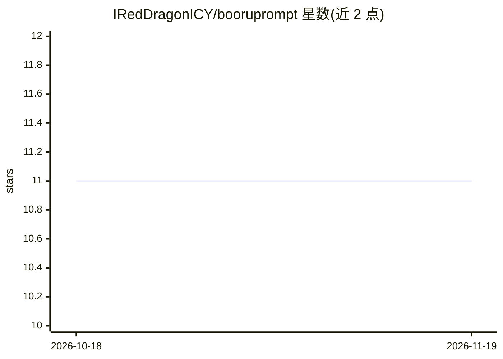

# IRedDragonICY/booruprompt

⭐ 11 · TypeScript · MIT · 推送 2026-05-02 · [GitHub](https://github.com/IRedDragonICY/booruprompt) · [官网](https://booruprompt.vercel.app) · 个人维护

**给创作者/prompt工程师：从 booru 帖子提取分类标签并复制**

基于 Next.js 的网页工具：粘贴 booru 站点帖子 URL，抓取并展示该帖标签，按 Copyright/Character/General/Meta/Other 分类，支持类别开关、关键词黑名单和一键复制逗号分隔标签。附带 PNG 元数据读取（提取 Positive/Negative prompt 与参数）、服务器代理抓图、本地历史记录，不存储服务端数据。提供公开 API 端点与 Tauri 桌面打包及实验性 Android 工具。

## 筛选速览

| 维度 | 判定 | 备注 |
|---|---|---|
| AI 角色 | `ai-enhanced` | 去掉 AI 部分产品仍成立 |
| 许可风险 | `permissive` | MIT |
| 部署形态 | `library` | 以包/库形式分发 |
| 模型依赖 | — | README 未给出锁定关系 |
| 硬件要求 | — | 无带数字的原话,不猜 |
| 安装摩擦 | `low` | 无编译、无系统依赖或容器化 |
| 成熟度 | — | 结构信号不足 |

## 能力要点

- 粘贴 URL 自动/手动提取并五类分组标签
- PNG 元数据读取 Positive/Negative prompt 与参数
- 17 个 booru/Pixiv/Fur Affinity 站点的抓取支持
- 公开 POST 提取与图片代理 API，含 curl 示例

## 适用场景

- 为图像生成工作流快速复制帖子标签做 prompt
- 从 PNG 文件恢复生成时的正反向提示词与参数
- 按类别过滤并屏蔽不需要的关键词后复制标签

## 场景标签

`提示工程` `网页抓取` · 领域:Agent 开发

## 证据(README 行号)

> L33: Designed for creators, curators, and prompt engineers who need reliable tags quickly. Paste a post URL, get clean, 
> L221: booru tag extractor, danbooru tags, gelbooru tags, e621 tags, pixiv tags, rule34 tags, booru prompt generator, cop

## 星数曲线

2026-10-18 11 → 2026-11-19 11（+0）

---
*卡片 v1 · prompt 1.4 · 生成 2026-11-19 · 置信度 mid · 依据 README sha `34dc19d3dd60` · [字段定义](../../DATASET.md)*
