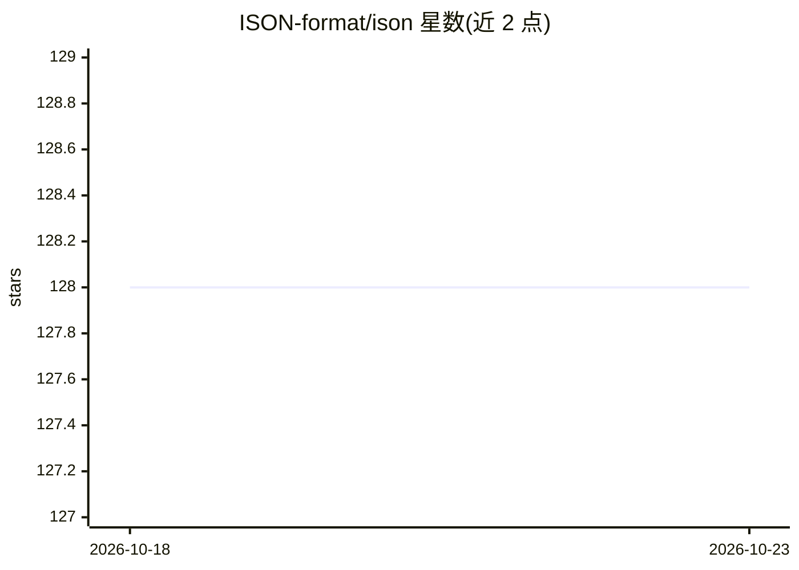

# ISON-format/ison

⭐ 128 · Python · MIT · 推送 2026-09-03 · [GitHub](https://github.com/ISON-format/ison) · [官网](https://www.ison.dev) · 个人维护

**面向 LLM/Agent 工作流的省 token 数据序列化格式与多语言解析器**

ISON 是一种表格式数据格式：字段名只在块头声明一次，行按位置排列，支持类型注解、`:id` 引用与行式流式形态 ISONL；据其基准（GPT-4o 分词器，300 题），相较 JSON 减少 72% token，准确率 88.3%。提供 Python/JS/TS/C#/Go/Rust/C++ 七种实现，均暴露 loads/dumps API，经共享语料在每次构建中强制跨语言输出一致。ISONCS 规范化序列化保证相同数据产出相同字节，用于内容寻址与 prompt 缓存命中。附带 CLI、VS Code 插件与 n8n 节点。面向在多 Agent、RAG、函数调用场景中传递结构化数据的开发者。

## 筛选速览

| 维度 | 判定 | 备注 |
|---|---|---|
| AI 角色 | `ai-ecosystem` | LLM/agent 周边工具 |
| 许可风险 | `permissive` | MIT |
| 部署形态 | `library` | 以包/库形式分发 |
| 模型依赖 | — | README 未给出锁定关系 |
| 硬件要求 | — | 无带数字的原话,不猜 |
| 安装摩擦 | `low` | 无编译、无系统依赖或容器化 |
| 成熟度 | — | 结构信号不足 |

## 能力要点

- 字段名声明一次、行按位置排列的表格式格式，官方基准中较 JSON 少 72% token
- 七种语言实现经共享语料在每次构建中做跨语言一致性校验
- ISONCS 规范化序列化保证相同数据产出相同字节（内容寻址、缓存友好）
- ISONL 行式流式形态与内置 schema 校验（多语言）

## 适用场景

- 多 Agent 系统间传递状态时压缩 token 开销
- RAG 流水线在相同上下文窗口内装入更多检索内容
- 用规范化输出做内容寻址与稳定 prompt 前缀以命中缓存
- 在 n8n 工作流或命令行中转换、校验 ISON 与 JSON

## 场景标签

 · 领域:LLM 基础设施/数据格式

## 证据(README 行号)

> L3:  A minimal, token-efficient data format optimized for LLMs and Agentic AI workflows.
> L60: - **Multi-agent systems** — agents pass state constantly; every message is tokens
> L61: - **RAG pipelines** — more retrieved context in the same window

## 星数曲线

2026-10-18 128 → 2026-10-23 128（+0）

---
*卡片 v1 · prompt 1.4 · 生成 2026-10-23 · 置信度 high · 依据 README sha `f56a823d9f86` · [字段定义](../../DATASET.md)*
