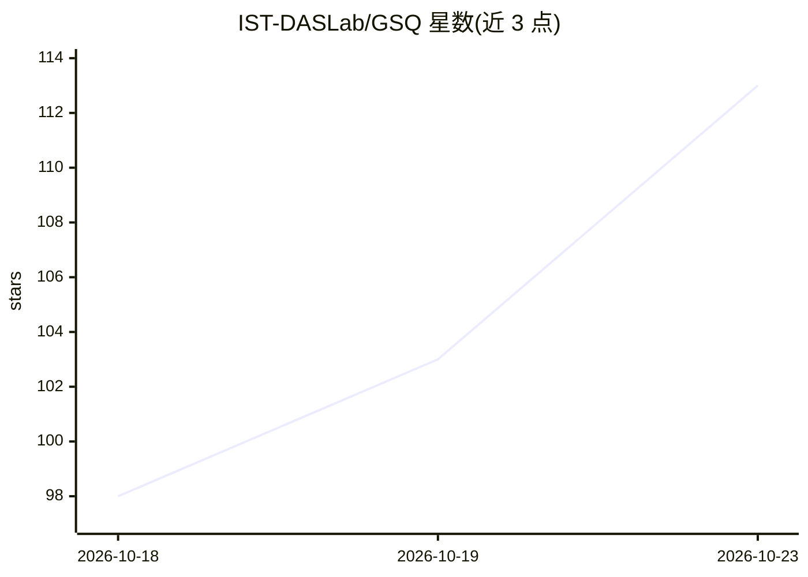

# IST-DASLab/GSQ

⭐ 113 · Python · Apache-2.0 · 推送 2026-07-11 · [GitHub](https://github.com/IST-DASLab/GSQ) · [官网](https://huggingface.co/collections/ISTA-DASLab/gsq) · 组织维护

**面向 LLM 的 1–3 bit 后训练量化方法（Gumbel-Softmax，GGUF 兼容）**

来自 ISTA/ETH Zürich/TU Wien/Red Hat AI 团队的后训练标量量化方法 GSQ：先以 GPTQ 初始化，再用 Gumbel-Softmax 松弛训练每个权重在离散网格上的分配与逐组 scale，输出对称、分组式标量格式，可直接落入现有 INT 推理内核与 GGUF K-Quant 部署栈。支持 LLaMA、Qwen3 系列、Gemma-4、Kimi K2/K2.5 等稠密与 MoE 模型，可逐层 offload 量化超出显存的模型，并可原格式精修公开 GGUF K-Quant checkpoint。限制：仅测试于 NVIDIA Hopper；vLLM 服务步骤要求 sm ≥ 80；使用 uv 管理环境，从源码运行。

## 筛选速览

| 维度 | 判定 | 备注 |
|---|---|---|
| AI 角色 | `ai-ecosystem` | LLM/agent 周边工具 |
| 许可风险 | `permissive` | Apache-2.0 |
| 部署形态 | `library` | 以包/库形式分发 |
| 模型依赖 | local-ok | 支持本地模型 |
| 硬件要求 | — | 无带数字的原话,不猜 |
| 安装摩擦 | `medium` | 含编译或系统依赖之一 |
| 成熟度 | — | 结构信号不足 |

## 能力要点

- GPTQ 初始化 + Gumbel-Softmax 离散网格精修的两阶段量化
- 输出对称分组标量格式，兼容 INT 内核与 GGUF K-Quant，可在 llama.cpp/Ollama 上原样运行
- 支持 2-bit / n-bit / 三值（~1.58-bit）方案与稠密、MoE 模型（含 Kimi-K2.5）
- 逐层 offload 到 meta device，可量化超出 GPU 显存的模型

## 适用场景

- 把大模型压缩到 2–3 bit 以降低显存与部署体积
- 在不改变 GGUF K-Quant 格式的前提下精修公开量化 checkpoint
- 为 vLLM 生成 compressed-tensors 格式的低比特 checkpoint

## 场景标签

`模型量化` · 领域:训练与推理

## 证据(README 行号)

> L12: GSQ is a **post-training scalar quantization** method that learns per-coordinate grid assignments and per-group sca
> L54: 3. **Layer offloading** — each completed layer is saved as compressed `.safetensors` shards and offloaded to a `met
> L55: 4. **Model reassembly** — `save_model.py` merges the per-layer shards into a complete HuggingFace-compatible checkp

## 星数曲线

2026-10-18 98 → 2026-10-23 113（+15）

---
*卡片 v1 · prompt 1.4 · 生成 2026-10-23 · 置信度 mid · 依据 README sha `64406e4ce27c` · [字段定义](../../DATASET.md)*
