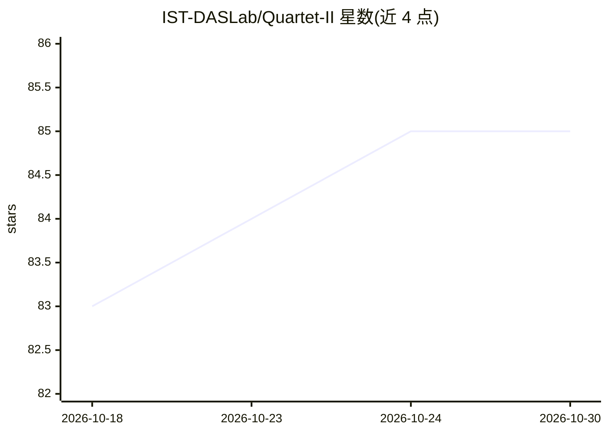

# IST-DASLab/Quartet-II

⭐ 85 · Python · 推送 2026-05-01 · [GitHub](https://github.com/IST-DASLab/Quartet-II) · 组织维护

**NVFP4 格式 LLM 预训练量化（QAT）官方代码与内核**

ICML 2026 论文 Quartet II 的官方实现：通过改进的无偏梯度估计在 NVFP4 格式下进行 LLM 预训练/量化感知训练。提供面向 RTX 5090（sm120a）与 B200（sm100）调优的 NVFP4 内核（测试环境 CUDA 13.0 / PyTorch 2.10 / Python 3.11），可作为 nn.Linear 的直接替换模块使用，附带 SLURM sweep 脚本与基准测试脚本。面向从事 LLM 低精度训练研究的研究者与工程师。

## 筛选速览

| 维度 | 判定 | 备注 |
|---|---|---|
| AI 角色 | `ai-ecosystem` | LLM/agent 周边工具 |
| 许可风险 | `none` | — |
| 部署形态 | `library` | 以包/库形式分发 |
| 模型依赖 | — | README 未给出锁定关系 |
| 硬件要求 | — | 无带数字的原话,不猜 |
| 安装摩擦 | `medium` | 含编译或系统依赖之一 |
| 成熟度 | — | 结构信号不足 |

## 能力要点

- 改进无偏梯度估计的 NVFP4 量化感知预训练方案
- 面向 RTX 5090（sm120a）与 B200（sm100）的 NVFP4 内核
- 提供 drop-in 的 nn.Linear 替换模块 Quartet_II_linear
- 附 SLURM sweep 脚与内核基准脚本

## 适用场景

- 在 NVFP4 精度下复现论文的 LLM 预训练实验
- 将现有模型中的 nn.Linear 替换为 NVFP4 线性层
- 对比 NVFP4 与 BF16/FP8 内核性能

## 场景标签

`模型量化` `模型训练` · 领域:训练与推理

## 证据(README 行号)

> L1: # Quartet II: Accurate LLM Pre-Training in NVFP4 by Improved Unbiased Gradient Estimation
> L39: The kernels were tested with **CUDA 13.0**, **PyTorch 2.10** and **Python 3.11**. Install them with

## 星数曲线

2026-10-18 83 → 2026-10-30 85（+2）

---
*卡片 v1 · prompt 1.4 · 生成 2026-10-24 · 置信度 high · 依据 README sha `cefe5756e21b` · [字段定义](../../DATASET.md)*
