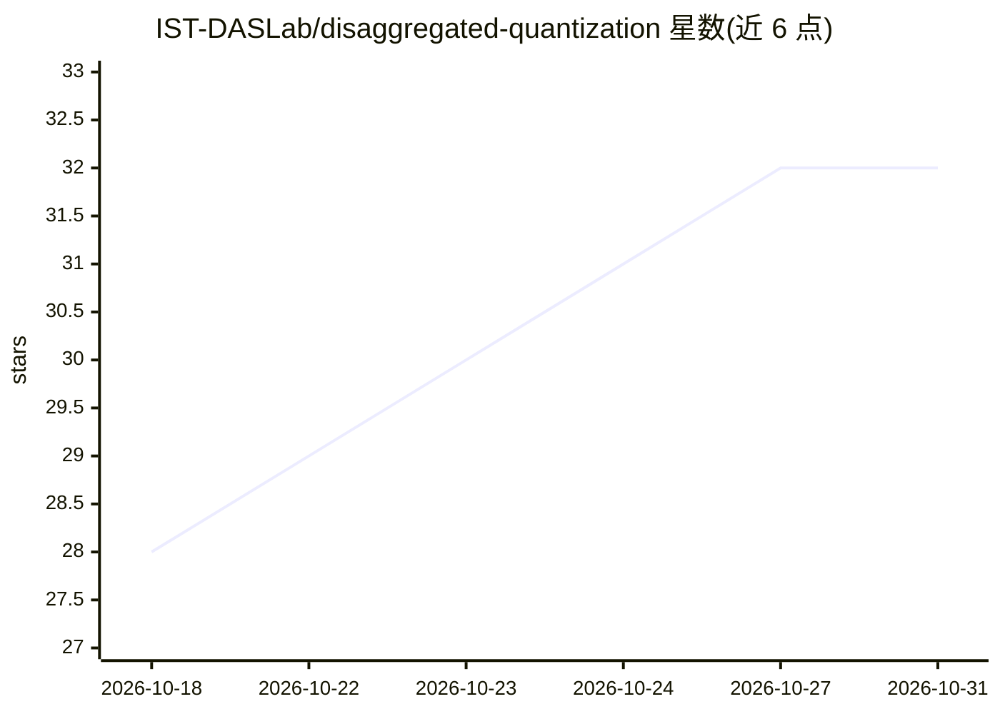

# IST-DASLab/disaggregated-quantization

⭐ 32 · Jupyter Notebook · 推送 2026-10-21 · [GitHub](https://github.com/IST-DASLab/disaggregated-quantization) · [官网](https://arxiv.org/abs/2609.26333) · 组织维护

**LLM 预填充/解码阶段差异化量化（DQ）的研究代码库**

IST-DASLab 发布的论文官方代码库：提出 disaggregated quantization，为 LLM 的 prefill 与 decode 阶段分别配置计算格式与权重（如 NVFP4 原生 prefill + 权重仅量化 decode），并通过 QADD 量化感知蒸馏训练两条路径。提供 Qwen3.8-27B NVFP4 prefiller 检查点（Hugging Face），支持 SSD 卸载 prefill 权重的 ODP 方案，含 vLLM 分离式 serving 与 llama.cpp 集成。复现需 SLURM/容器集群与多 GPU（默认 4 GPU/节点×2 节点），面向科研人员。

## 筛选速览

| 维度 | 判定 | 备注 |
|---|---|---|
| AI 角色 | `ai-ecosystem` | LLM/agent 周边工具 |
| 许可风险 | `none` | — |
| 部署形态 | `None` |  |
| 模型依赖 | local-ok | 支持本地模型 |
| 硬件要求 | — | 无带数字的原话,不猜 |
| 安装摩擦 | `medium` | 含编译或系统依赖之一 |
| 成熟度 | — | 结构信号不足 |

## 能力要点

- prefill/decode 阶段分别选择量化格式与权重存储
- QADD 蒸馏一次前向反向同时训练两条路径
- ODP 从 SSD 流式加载 prefill 权重，不增加设备权重驻留
- 提供 vLLM 分离式 serving 与 llama.cpp 集成

## 适用场景

- 复现论文中 Qwen 3 / Gemma 3 的量化训练与评测实验
- 在不重训已发布量化 decoder 的情况下训练 NVFP4 prefiller
- 生成论文图表与表格

## 场景标签

`模型量化` · 领域:训练与推理

## 证据(README 行号)

> L8: Prefill and decode reward different quantization choices: hardware-native low-precision
> L10: traffic during generation. **Disaggregated quantization (DQ)** specializes computation
> L104: |qad/training/, qad/quantizers/, qad/export/|QADD, phase-specific formats and checkpoint export|
> L113: The launch scripts target a SLURM/container environment, not a standalone laptop.

## 星数曲线

2026-10-18 28 → 2026-10-31 32（+4）

---
*卡片 v1 · prompt 1.4 · 生成 2026-10-26 · 置信度 high · 依据 README sha `ecbb3fd77d5c` · [字段定义](../../DATASET.md)*
