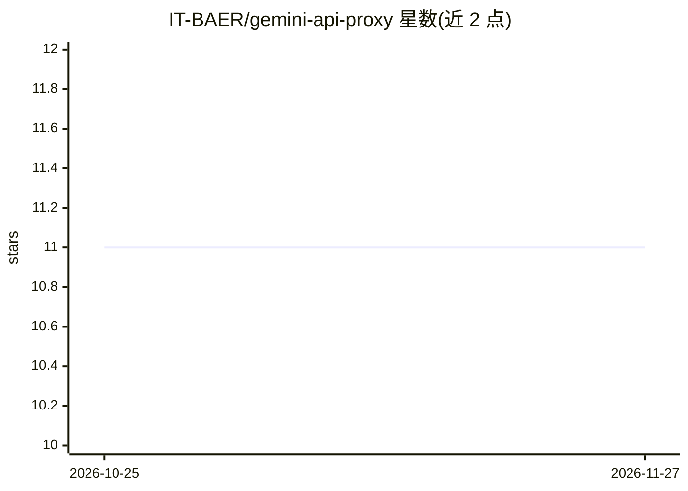

# IT-BAER/gemini-api-proxy

⭐ 11 · Python · MIT · 推送 2026-01-21 · [GitHub](https://github.com/IT-BAER/gemini-api-proxy) · 个人维护

**把 Gemini Code Assist 转成 OpenAI/Anthropic 兼容 API 的反向代理**

反向代理服务，调用 Google Gemini Code Assist 的内部 API 端点，并以 OpenAI Chat Completions 与 Anthropic Messages 兼容端点对外提供，供支持这两种 API 格式的工具直接接入。提供 Web 用量仪表盘（请求状态、错误日志）、流式响应的字符估算、可配置的速率限制与排队（RATE_LIMIT/WAIT_MODE）、模型名别名映射，以及满足客户端校验的确定性 mock embeddings 端点。通过 Google OAuth 授权，README 警示使用未公开端点可能违反 Google 服务条款、存在账号受限风险。

## 筛选速览

| 维度 | 判定 | 备注 |
|---|---|---|
| AI 角色 | `ai-ecosystem` | LLM/agent 周边工具 |
| 许可风险 | `permissive` | MIT |
| 部署形态 | `library` | 以包/库形式分发 |
| 模型依赖 | — | README 未给出锁定关系 |
| 硬件要求 | — | 无带数字的原话,不猜 |
| 安装摩擦 | `low` | 无编译、无系统依赖或容器化 |
| 成熟度 | — | 结构信号不足 |

## 能力要点

- 提供 /v1/chat/completions、/v1/messages 等 OpenAI/Anthropic 兼容端点
- Web 仪表盘实时展示请求状态、token 方向与错误日志
- 可配置请求限速与排队模式以规避 429
- 模型名别名映射与 mock embeddings 端点

## 适用场景

- 让仅支持 OpenAI API 的工具接入 Gemini Code Assist
- 本地统一代理多个工具的模型请求并查看用量
- n8n 等需要模型列表接口的工具兼容接入

## 场景标签

`模型网关` · 领域:Agent 开发

## 证据(README 行号)

> L3: A reverse proxy for the Google Gemini Code Assist API that exposes it as an OpenAI and Anthropic compatible service.
> L27: - **OpenAI & Anthropic Compatibility**: Exposes Gemini Code Assist as OpenAI-compatible (`/v1/chat/completions`, `/

## 星数曲线

2026-10-25 11 → 2026-11-27 11（+0）

---
*卡片 v1 · prompt 1.4 · 生成 2026-11-19 · 置信度 high · 依据 README sha `658321d14052` · [字段定义](../../DATASET.md)*
