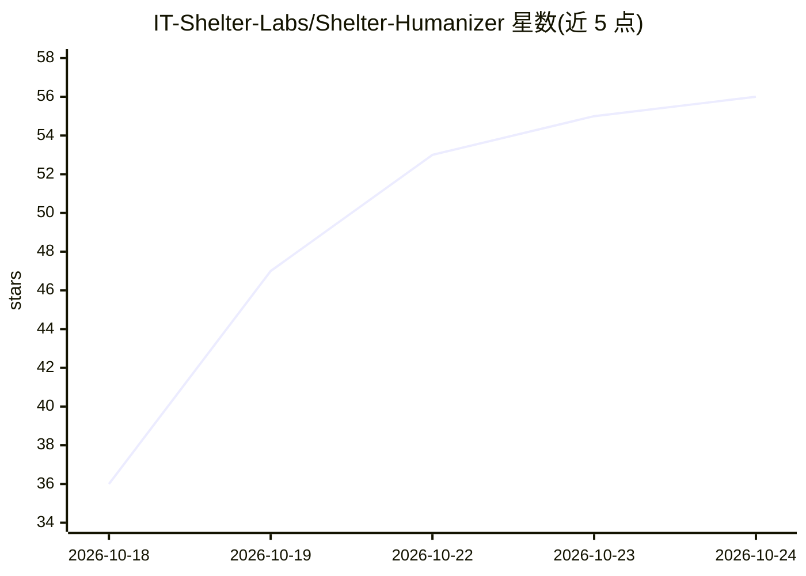

# IT-Shelter-Labs/Shelter-Humanizer

⭐ 57 · Python · MIT · 推送 2026-10-16 · [GitHub](https://github.com/IT-Shelter-Labs/Shelter-Humanizer) · [官网](https://t.me/+ihTcvubt-_BhZTQ6) · 组织维护

**面向俄语文本改写的 Windows 桌面编辑器，支持本地 LLM**

Windows 桌面应用（Tk/ttk + Python 标准库，无 PyPI 运行时依赖），提供 AI 文本改写、风格调整与 Unicode 隐藏字符清理。处理方式四种：内置本地模型（向导下载便携版 Ollama，默认 Qwen 3.5 4B，建议 16GB RAM）、外部 AI 聊天手工搬运、OpenAI 兼容 API（密钥经环境变量传入）、无 AI 规则模式。内置模式校验数字/引号/链接/代码是否保留，输出修改清单；不检测抄袭或 AI 生成痕迹。另带 CLI 与 agent skill。Linux 无二进制，AI 安装向导仅限 Windows。

## 筛选速览

| 维度 | 判定 | 备注 |
|---|---|---|
| AI 角色 | `ai-enhanced` | 去掉 AI 部分产品仍成立 |
| 许可风险 | `permissive` | MIT |
| 部署形态 | `desktop` | 安装包/桌面程序 |
| 模型依赖 | local-ok | 支持本地模型 |
| 硬件要求 | — | 无带数字的原话,不猜 |
| 安装摩擦 | `low` | 无编译、无系统依赖或容器化 |
| 成熟度 | — | 结构信号不足 |

## 能力要点

- 四种处理模式：本地 Ollama 模型 / 外部聊天搬运 / OpenAI 兼容 API / 无 AI 规则模式
- 改写后校验数字、引号、链接、代码与指定术语的保留情况
- 隐藏 Unicode 字符检测与清理（BOM、软连字符、特殊空格、NFC）
- CLI 提供 analyze/light/prompt/rewrite 命令，支持 --provider ollama

## 适用场景

- 把 AI 生成的文本改写为更自然的表述并清理隐藏字符
- 在本地离线运行模型完成改写，不把文本发给外部服务
- 检查文本中的不可见 Unicode 插入与编码问题

## 场景标签

`AI 写作` · 领域:内容生成

## 证据(README 行号)

> L38: перенести ответ обратно. В режиме **«Без ИИ»** доступны проверка символов,
> L75: |Способ|Для чего|Что нужно|
> L77: |**ИИ на компьютере**|Переписывание локальной моделью|Windows-мастер, место на диске и достаточная память|

## 星数曲线

2026-10-18 36 → 2026-10-24 56（+20）

---
*卡片 v1 · prompt 1.4 · 生成 2026-10-24 · 置信度 high · 依据 README sha `02773d98bef7` · [字段定义](../../DATASET.md)*
