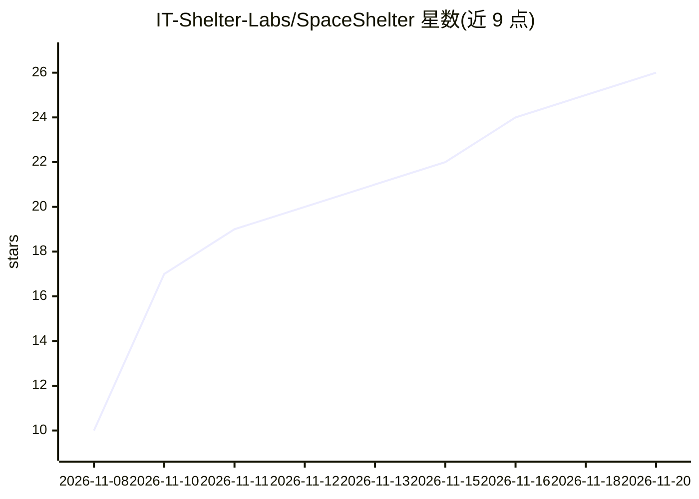

# IT-Shelter-Labs/SpaceShelter

⭐ 26 · Rust · MIT · 推送 2026-10-25 · [GitHub](https://github.com/IT-Shelter-Labs/SpaceShelter) · 组织维护

**带本地 AI 辅助的磁盘空间分析与清理工具**

Rust 编写的 Windows/Linux 桌面磁盘分析工具：生成占用地图与文件夹大小，单次扫描后从保存的索引打开嵌套目录，无需重复遍历。AI 为可选功能：通过 Ollama 使用一个多模态本地模型解释文件用途、描述图片、按用户选择读取文本片段，并在清理前展示删除影响；扫描本身不需要模型。清理需确认并默认送入回收站，模型不自行删除。支持四种界面语言，提供预编译包与源码构建两种方式。

## 筛选速览

| 维度 | 判定 | 备注 |
|---|---|---|
| AI 角色 | `ai-enhanced` | 去掉 AI 部分产品仍成立 |
| 许可风险 | `permissive` | MIT |
| 部署形态 | `desktop` | 安装包/桌面程序 |
| 模型依赖 | local-ok | 支持本地模型 |
| 硬件要求 | — | 无带数字的原话,不猜 |
| 安装摩擦 | `low` | 无编译、无系统依赖或容器化 |
| 成熟度 | — | 结构信号不足 |

## 能力要点

- 单次扫描生成索引，嵌套文件夹免重复遍历
- 本地多模态模型解释文件用途、描述图片、分析文本片段
- 清理前显示计划，默认送回收站，模型不自行删除
- 四语言界面与亮/暗主题

## 适用场景

- 找出磁盘里占空间的大文件和文件夹
- 不确定某文件/图片是什么时让 AI 给出解释再决定是否删除
- 安全地确认并清理不需要的文件

## 场景标签

 · 领域:桌面工具/存储管理

## 证据(README 行号)

> L14: - **Помогает с помощью ИИ:** объясняет назначение файлов, разбирает вложенные папки и показывает последствия удален
> L23: 3. Выберите диск или папку и нажмите **«Анализировать»**. Нейросеть для сканирования не нужна.
> L24: 4. Для рекомендаций перейдите в **«Модель»**, выберите и скачайте модель. В Windows необходимая Ollama подготавлива

## 星数曲线

2026-11-08 10 → 2026-11-20 26（+16）

---
*卡片 v1 · prompt 1.4 · 生成 2026-11-18 · 置信度 high · 依据 README sha `3b1458f8d458` · [字段定义](../../DATASET.md)*
