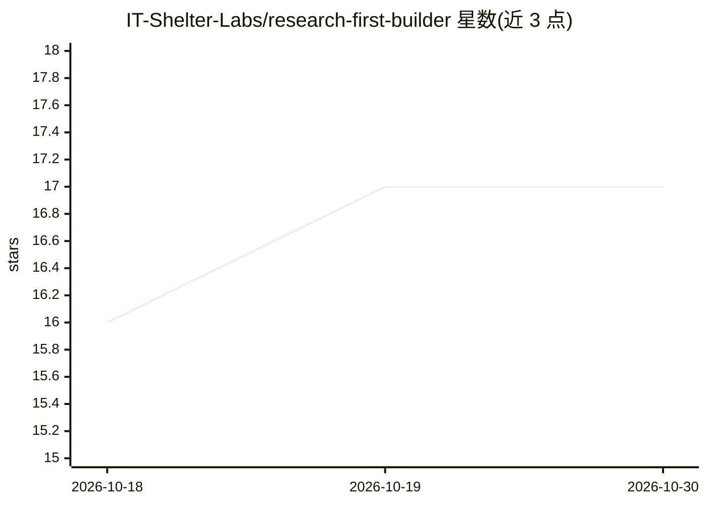

# IT-Shelter-Labs/research-first-builder

⭐ 17 · Python · MIT · 推送 2026-10-01 · [GitHub](https://github.com/IT-Shelter-Labs/research-first-builder) · [官网](https://t.me/+ihTcvubt-_BhZTQ6) · 组织维护

**让编码 agent 基于真实来源论证架构后再构建的技能**

由 IT Shelter 发布的可移植 agent 技能（research-first-build），供 Codex、Claude Code、Cursor、OpenCode 等编码 agent 使用。它约束 agent 按 Research→Evidence→Evaluate→Reject/Adopt→Design→Plan→Build→Verify 流程工作，先检视 3-5 个真实参考项目，把决策记录为 ADOPT/REJECT/DEFER，并输出 RESEARCH.md、PLAN.md 与 evidence.json 账本。附带离线 Python 脚本 rfb.py 负责初始化模板、渲染表格与一致性校验，不做网络调用、不执行研究。当前为 0.1.0-rc1 预览版，原生选择器验收与对比评估尚未完成。

## 筛选速览

| 维度 | 判定 | 备注 |
|---|---|---|
| AI 角色 | `ai-ecosystem` | LLM/agent 周边工具 |
| 许可风险 | `permissive` | MIT |
| 部署形态 | `library` | 以包/库形式分发 |
| 模型依赖 | — | README 未给出锁定关系 |
| 硬件要求 | — | 无带数字的原话,不猜 |
| 安装摩擦 | `low` | 无编译、无系统依赖或容器化 |
| 成熟度 | `idea` | |

## 能力要点

- 将真实参考转化为 ADOPT/REJECT/DEFER 决策并输出研究报告与计划文档
- 离线助手 rfb.py 提供 init/render/check 三阶段校验（Python 3.11+，无额外依赖）
- 单一自包含技能文件夹，无需 RFB 账户、后端、MCP 服务器或付费 API
- 支持 research-only 模式与可调研究深度（quick 2-3 / default 3-5 / deep 至 7 个来源）

## 适用场景

- 让编码 agent 在动手前调研并论证技术选型
- 记录每个架构决策的证据、代价与复访触发条件
- 为有重大设计取舍的新项目或子系统生成可审计的研究与计划文档

## 场景标签

`提示工程` · 领域:Agent 开发

## 证据(README 行号)

> L9: Research First Builder is a portable agent skill by IT Shelter.
> L26: Claude Code: start with `/research-first-build` and the same task. For any host, explicitly asking it to use
> L83: Use it for a new project or a substantial subsystem with consequential design choices. A routine bug fix does not n

## 星数曲线

2026-10-18 16 → 2026-10-30 17（+1）

---
*卡片 v1 · prompt 1.4 · 生成 2026-10-30 · 置信度 high · 依据 README sha `bbdfee8945f5` · [字段定义](../../DATASET.md)*
