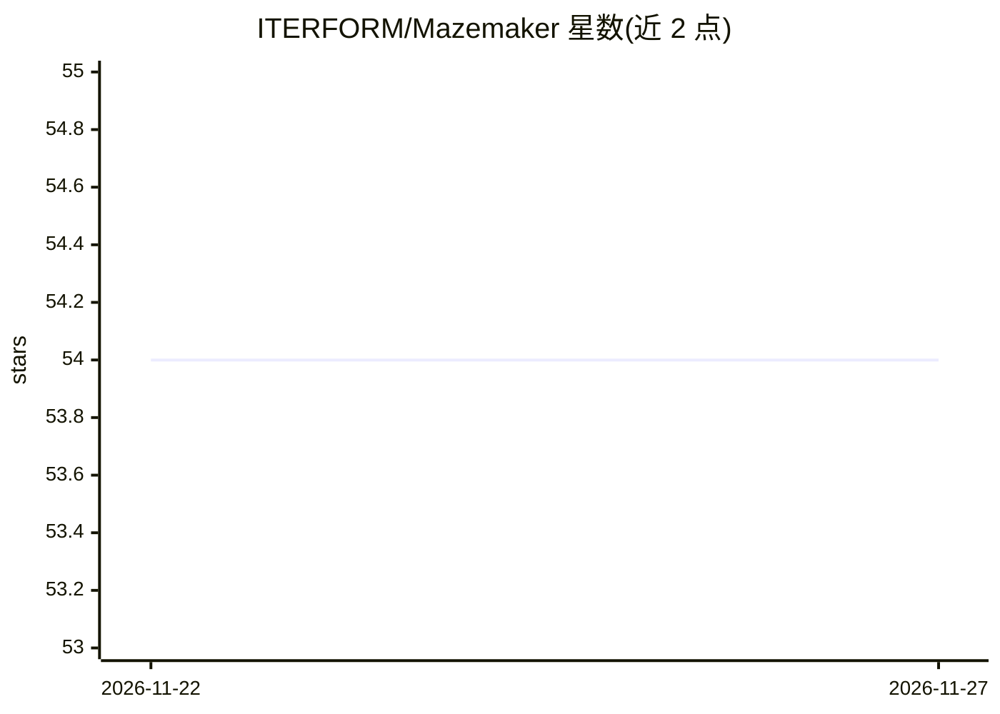

# ITERFORM/Mazemaker

⭐ 54 · Python · NOASSERTION · 推送 2026-11-12 · [GitHub](https://github.com/ITERFORM/Mazemaker) · [官网](https://mazemaker.online) · 个人维护

**给 MCP AI 代理提供持久化语义记忆与知识图谱的系统**

面向 MCP 代理的本地语义记忆系统：把对话持续转化为知识图谱（原子事实、语义链接、取代链、抽象综合），采用 BGE-M3 嵌入、ColBERT 重排、个性化 PageRank 图遍历与冲突取代机制，并运行受生物睡眠启发的后台「做梦」整合周期（NREM/REM/Insight）。支持 MCP 工具接入、HTTP(S) pod 联邦传播。提供托管安装脚本与自托管两条路径，社区版永久免费，Pro 版开启 REM、Insight 综合、Postgres 后端与联邦等功能；许可为 AGPLv3 + PolyForm-NC 双许可。

## 筛选速览

| 维度 | 判定 | 备注 |
|---|---|---|
| AI 角色 | `ai-ecosystem` | LLM/agent 周边工具 |
| 许可风险 | `none` | NOASSERTION |
| 部署形态 | `library` | 以包/库形式分发 |
| 模型依赖 | — | README 未给出锁定关系 |
| 硬件要求 | — | 无带数字的原话,不猜 |
| 安装摩擦 | `low` | 无编译、无系统依赖或容器化 |
| 成熟度 | `idea` | |

## 能力要点

- 知识图谱式记忆：取代链、桥接记忆与潜偏好结构，支持跨会话存续
- 自主做梦整合引擎：600s 空闲或 50 条新记忆后触发 NREM/REM/Insight 周期
- BGE-M3 嵌入 + ColBERT 重排 + 个性化 PageRank 的分层检索管线
- 9 个 MCP 工具接入，支持 pod 间 HTTP(S) 联邦记忆传播

## 适用场景

- 让 MCP 代理跨会话记住偏好演变并解决前后矛盾
- 多代理团队通过联邦同步各自的记忆图谱
- 需要追踪时间链与推断潜在特质的长期代理应用

## 场景标签

`Agent 记忆` `知识图谱` · 领域:Agent 开发

## 证据(README 行号)

> L41: It works with MCP agents.
> L203: |MCP tools|✅|✅|
> L249: |`docs/mcp-tools.md`|Nine tools, input/output JSON, integration shapes, quick-starts|

## 星数曲线

2026-11-22 54 → 2026-11-27 54（+0）

---
*卡片 v1 · prompt 1.4 · 生成 2026-11-22 · 置信度 high · 依据 README sha `41894157c908` · [字段定义](../../DATASET.md)*
