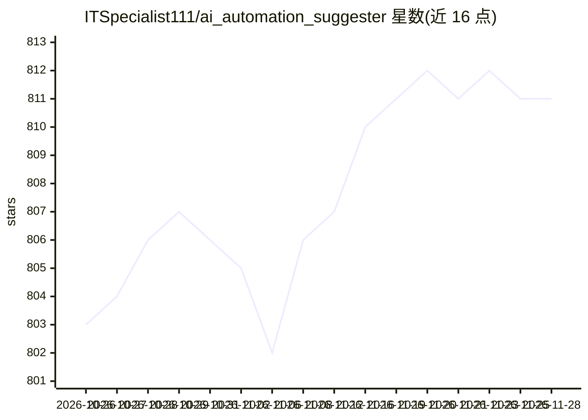

# ITSpecialist111/ai_automation_suggester

⭐ 811 · Python · MIT · 推送 2026-10-25 · [GitHub](https://github.com/ITSpecialist111/ai_automation_suggester) · 个人维护

**Home Assistant 集成：用 AI 分析家居实体并生成自动化 YAML 建议**

以 Home Assistant 自定义集成形式安装，手动触发或按计划对实例中的实体、设备、区域和既有自动化做快照，将其嵌入系统提示后发送给用户配置的 AI 提供商，解析返回的结构化 JSON/YAML 并校验，生成可直接粘贴的自动化建议。建议通过持久通知、sensor 属性和内置仪表盘卡片展示，支持历史留存与接受/拒绝标记。需自行配置 API key 或本地模型服务器，建议不会自动实施。

## 筛选速览

| 维度 | 判定 | 备注 |
|---|---|---|
| AI 角色 | `ai-native` | 本体是模型或模型工具 |
| 许可风险 | `permissive` | MIT |
| 部署形态 | `None` |  |
| 模型依赖 | local-ok | 支持本地模型 |
| 硬件要求 | — | 无带数字的原话,不猜 |
| 安装摩擦 | `low` | 无编译、无系统依赖或容器化 |
| 成熟度 | — | 结构信号不足 |

## 能力要点

- 分析实体/设备/区域/既有自动化后生成可粘贴的 YAML 建议
- 支持多家云与本地 AI 提供商及 OpenAI 兼容端点
- 建议历史持久化，可标记接受/拒绝/忽略
- 随机实体抽取、领域过滤与自定义提示词

## 适用场景

- 设备多而自动化少，想发现新的自动化机会
- 不熟悉 YAML 却想创建 Home Assistant 自动化
- 定期审视现有自动化并获取改进建议

## 场景标签

 · 领域:智能家居/自动化工具

## 证据(README 行号)

> L12: An **AI‑powered assistant** for Home Assistant that leverages large language models to understand your unique smart
> L43: |**3&nbsp;· Provider Call**|Sends the prompt to the AI.|The crafted prompt is sent to your configured AI provider (
> L80: * **Multi-Provider Support:** Connect to OpenAI, OpenAI Azure, Anthropic, Google, Groq, LocalAI, Ollama, Mistral, P

## 星数曲线

2026-10-26 803 → 2026-11-28 811（+8）

---
*卡片 v1 · prompt 1.4 · 生成 2026-11-24 · 置信度 high · 依据 README sha `af09f45d6571` · [字段定义](../../DATASET.md)*
