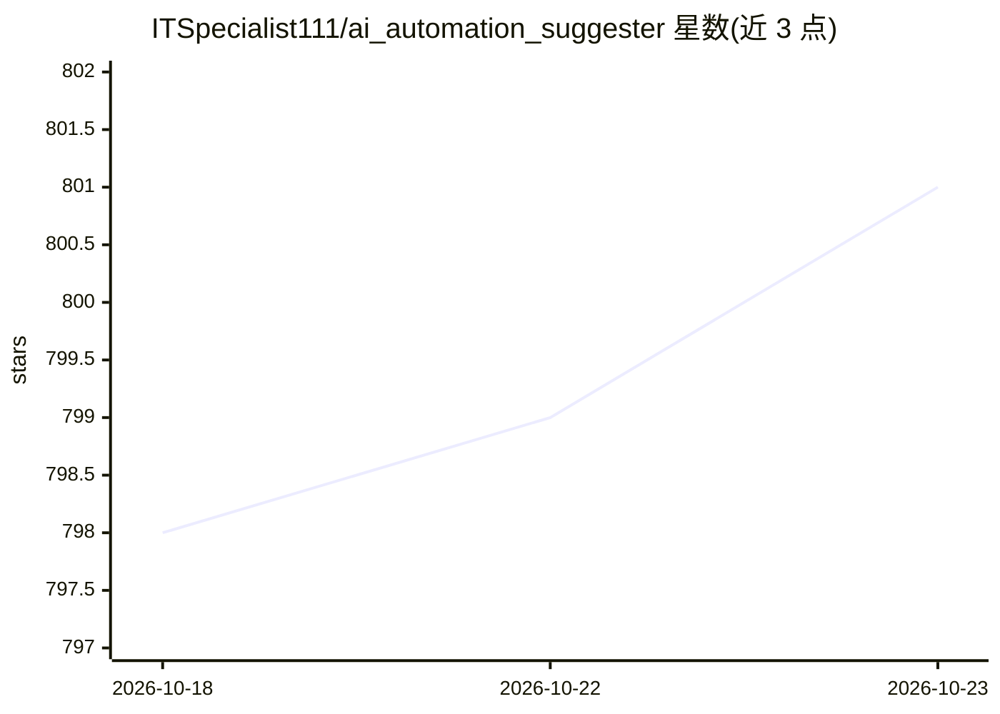

# ITSpecialist111/ai_automation_suggester

⭐ 801 · Python · MIT · 推送 2026-10-02 · [GitHub](https://github.com/ITSpecialist111/ai_automation_suggester) · 个人维护

**Home Assistant 集成：用 LLM 分析实体并生成自动化 YAML 建议**

面向 Home Assistant 用户（2024.1 及以上）的自定义集成：采集实体、设备、区域与现有自动化的快照，嵌入系统提示后发送给所选 AI 提供商（OpenAI、Azure OpenAI、Anthropic、Google、Groq、LocalAI、Ollama、Mistral、Perplexity、OpenRouter、Requesty、MiniMax、LiteLLM 或任意 OpenAI 兼容端点），解析返回内容并校验 YAML，以持久通知、传感器属性与历史记录形式呈现建议，供用户审阅后自行粘贴实现。支持自定义提示、实体过滤、随机实体选择、温度与令牌限额，建议不会自动应用。通过 HACS 或手动复制 custom_components 安装。

## 筛选速览

| 维度 | 判定 | 备注 |
|---|---|---|
| AI 角色 | `ai-native` | 本体是模型或模型工具 |
| 许可风险 | `permissive` | MIT |
| 部署形态 | `None` |  |
| 模型依赖 | local-ok | 支持本地模型 |
| 硬件要求 | — | 无带数字的原话,不猜 |
| 安装摩擦 | `low` | 无编译、无系统依赖或容器化 |
| 成熟度 | — | 结构信号不足 |

## 能力要点

- 多提供商支持：13+ 云/本地提供商及 OpenAI 兼容端点（LiteLLM 声称 100+ 后端）
- 快照→提示构建→提供商调用→解析校验 YAML→通知/传感器/历史五步流程
- 建议以持久通知与传感器属性呈现，含接受/拒绝/忽略审阅操作，不自动实现
- 自定义系统提示、域/实体过滤、随机实体选择与温度、令牌限额配置

## 适用场景

- 让 AI 根据我的智能家居现状给出可直接粘贴的自动化 YAML
- 新设备接入后触发分析，发现未利用的自动化机会
- 定期审查并更新随家庭环境变化的既有自动化

## 场景标签

 · 领域:智能家居/家庭自动化

## 证据(README 行号)

> L12: An **AI‑powered assistant** for Home Assistant that leverages large language models to understand your unique smart
> L43: |**3&nbsp;· Provider Call**|Sends the prompt to the AI.|The crafted prompt is sent to your configured AI provider (
> L99: * **Home Assistant:** Version 2024.1 or later.

## 星数曲线

2026-10-18 798 → 2026-10-23 801（+3）

---
*卡片 v1 · prompt 1.4 · 生成 2026-10-21 · 置信度 high · 依据 README sha `f738f35d53fb` · [字段定义](../../DATASET.md)*
