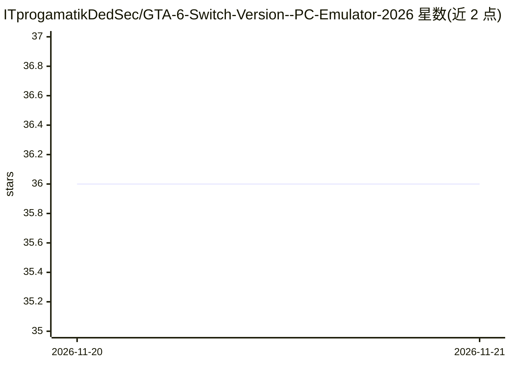

# ITprogamatikDedSec/GTA-6-Switch-Version--PC-Emulator-2026

⭐ 36 · Go · Apache-2.0 · 推送 2026-11-19 · [GitHub](https://github.com/ITprogamatikDedSec/GTA-6-Switch-Version--PC-Emulator-2026) · 个人维护

**面向 Windows 用户的 GTA VI PC 版安装准备与配置指南**

面向 Windows 10/11 游戏玩家的 GTA VI PC 版准备资料：覆盖 Windows 更新、GPU 驱动验证、存储检查、Rockstar Games Launcher 准备、图形与 FPS 优化选项说明及常见安装/性能问题排查清单。README 明确说明其安装包不含 GTA VI 游戏文件，仅为独立的 Windows 设置配套工具；官方 PC 版发布日期与系统需求截至文中日期均未确认，相关条目标注待更新。

## 筛选速览

| 维度 | 判定 | 备注 |
|---|---|---|
| AI 角色 | `ai-knowledge` | 知识聚合/清单类 |
| 许可风险 | `permissive` | Apache-2.0 |
| 部署形态 | `desktop` | 安装包/桌面程序 |
| 模型依赖 | — | README 未给出锁定关系 |
| 硬件要求 | — | 无带数字的原话,不猜 |
| 安装摩擦 | `low` | 无编译、无系统依赖或容器化 |
| 成熟度 | `idea` | |

## 能力要点

- Windows 兼容性准备清单（DirectX、驱动、存储、系统更新检查）
- 图形设置与 FPS 优化因素说明（分辨率、纹理、阴影、光追、超分、帧生成）
- 分步骤的 PC 准备指南与常见性能问题排查条目
- README 声明安装包不含游戏文件，游戏需经授权渠道获取

## 适用场景

- GTA VI PC 版发布前提前准备 Windows 环境
- 排查 PC 游戏常见的低 FPS、卡顿与显示问题
- 查阅 NVIDIA/AMD/Intel 官方驱动与 Rockstar 官方资源链接

## 场景标签

 · 领域:游戏/安装与配置指南

## 证据(README 行号)

> L17: This repository is dedicated to Windows users preparing for the future PC edition of GTA VI.
> L30: The GTA VI PC release date and official hardware requirements have not yet been announced.
> L238: No. The project installer is intended for a separate Windows setup companion. GTA VI must be acquired through an a

## 星数曲线

2026-11-20 36 → 2026-11-21 36（+0）

---
*卡片 v1 · prompt 1.4 · 生成 2026-11-20 · 置信度 low · 依据 README sha `6954d37a13d3` · [字段定义](../../DATASET.md)*
