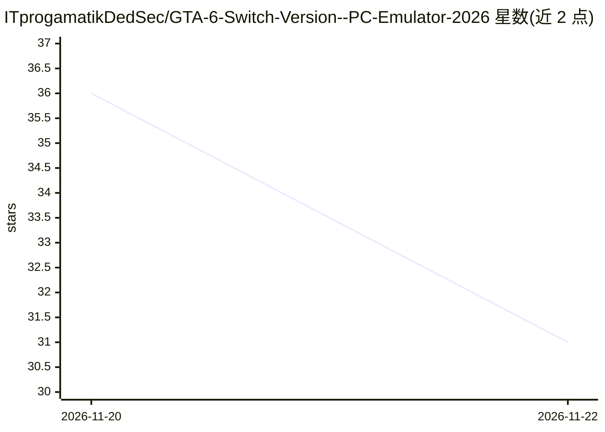

# ITprogamatikDedSec/GTA-6-Switch-Version--PC-Emulator-2026

⭐ 31 · Rust · Apache-2.0 · 推送 2026-11-21 · [GitHub](https://github.com/ITprogamatikDedSec/GTA-6-Switch-Version--PC-Emulator-2026) · 个人维护

**面向 Windows 玩家的 GTA VI PC 版安装与配置指南站点**

该仓库是一个 Windows 安装与配置资源，声称面向尚未发布 PC 版的 GTA VI，内容涵盖 Windows 环境准备、GPU 驱动更新（NVIDIA/AMD/Intel 官方链接）、存储检查、Rockstar Games Launcher 准备、画质与 FPS 优化建议及常见安装错误排查。自带一个不含游戏文件的 .exe 安装伴侣程序，官方系统需求表全部标注未确认。README 末尾含 SEO 关键词区块，全文无 AI 功能内容。

## 筛选速览

| 维度 | 判定 | 备注 |
|---|---|---|
| AI 角色 | `ai-knowledge` | 知识聚合/清单类 |
| 许可风险 | `permissive` | Apache-2.0 |
| 部署形态 | `desktop` | 安装包/桌面程序 |
| 模型依赖 | — | README 未给出锁定关系 |
| 硬件要求 | — | 无带数字的原话,不猜 |
| 安装摩擦 | `low` | 无编译、无系统依赖或容器化 |
| 成熟度 | — | 结构信号不足 |

## 能力要点

- 提供 Windows 兼容性准备清单（系统版本、DirectX、驱动、存储检查）
- 包含画质与 FPS 优化建议及常见性能问题排查
- 自带 .exe 形式的 Windows 安装伴侣程序（不含游戏文件）

## 适用场景

- 在 GTA VI PC 版发布前准备 Windows 游戏环境
- 查阅 PC 游戏通用的画质与帧率优化方法
- 排查安装错误与显示问题

## 场景标签

 · 领域:游戏/桌面工具

## 证据(README 行号)

> L3: ### GTA 6 PC Installation, Setup & Performance Guide
> L19: The installation resource focuses on:
> L266: ## 🔎 SEO Keywords

## 星数曲线

2026-11-20 36 → 2026-11-22 31（-5）

---
*卡片 v1 · prompt 1.4 · 生成 2026-11-22 · 置信度 low · 依据 README sha `2fe487426686` · [字段定义](../../DATASET.md)*
