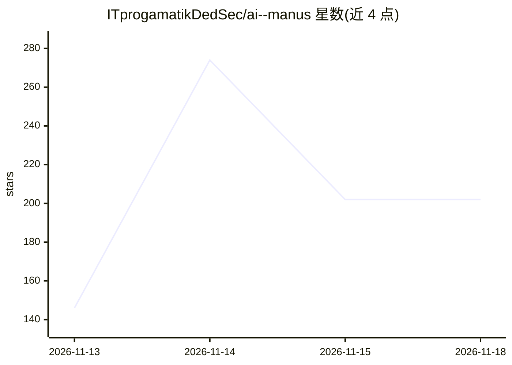

# ITprogamatikDedSec/ai--manus

⭐ 202 · Apache-2.0 · 推送 2026-11-17 · [GitHub](https://github.com/ITprogamatikDedSec/ai--manus) · 个人维护

**自主执行代码与浏览器操作的通用 AI Agent 系统**

README 描述的 Manus 是一个自主 AI Agent：代替用户编写并执行脚本、控制浏览器（导航网页、填写表单、采集信息），并可执行多步骤任务，官方说明其非聊天机器人而是直接采取行动。定位为面向家庭、学习与轻量办公场景的小型助手，而非企业平台；描述了最低硬件兼容表（双核 CPU / 4 GB 内存）与六步上手流程，但 README 未给出任何具体安装命令、源码结构或接入的模型服务商信息。

## 筛选速览

| 维度 | 判定 | 备注 |
|---|---|---|
| AI 角色 | `ai-native` | 本体是模型或模型工具 |
| 许可风险 | `permissive` | Apache-2.0 |
| 部署形态 | `None` |  |
| 模型依赖 | — | README 未给出锁定关系 |
| 硬件要求 | — | 无带数字的原话,不猜 |
| 安装摩擦 | `low` | 无编译、无系统依赖或容器化 |
| 成熟度 | — | 结构信号不足 |

## 能力要点

- 自主编写并执行代码完成任务
- 浏览器控制：导航网页、填表、采集信息
- 代码与浏览器操作可在同一任务流中衔接
- 会话间保持任务模式复用，支持后台运行

## 适用场景

- 让学生整理研究资料、跑小脚本而不学编程
- 代替我在多个网页间收集数据并做摘要
- 把重复性的小任务委托给后台 Agent 处理
- 远程技术支持中快速检查系统页面与诊断步骤

## 场景标签

`编码 Agent` `浏览器自动化` `AI 助手` · 领域:效率与自动化

## 证据(README 行号)

> L10: - **Autonomous Code Execution:** Manus AI agent runs code on its own to complete tasks, so you can focus on decisio
> L18: Manus is an autonomous AI agent designed to run code and control a browser on your behalf. Instead of acting like a

## 星数曲线

2026-11-13 146 → 2026-11-18 202（+56）

---
*卡片 v1 · prompt 1.4 · 生成 2026-11-18 · 置信度 mid · 依据 README sha `32e48e22fb91` · [字段定义](../../DATASET.md)*
